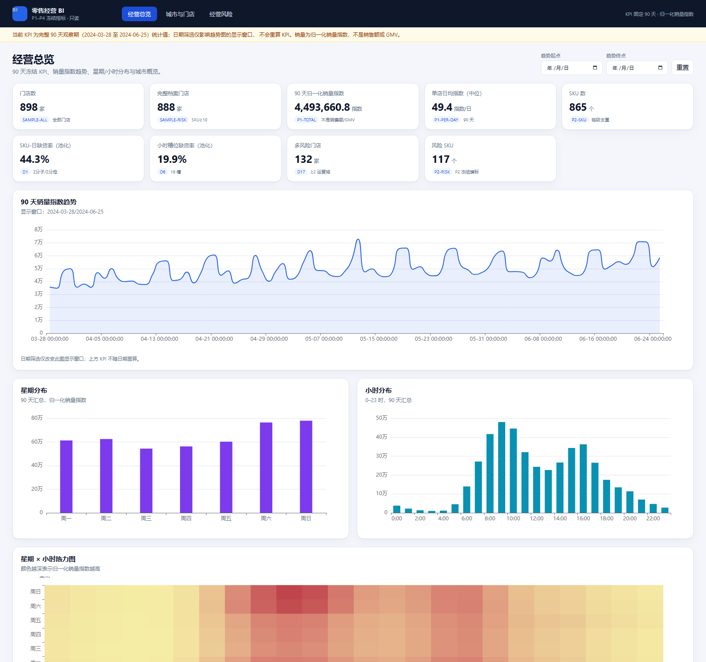
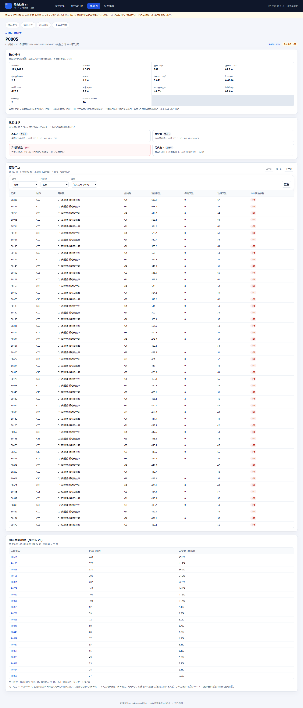
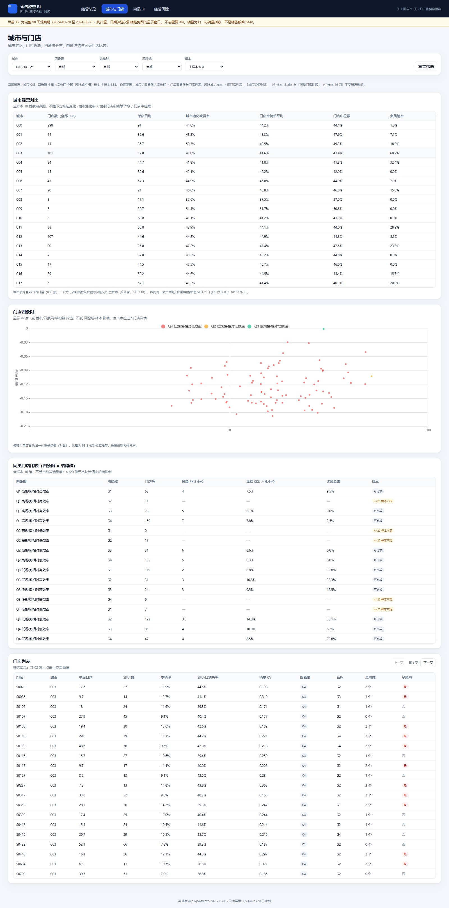
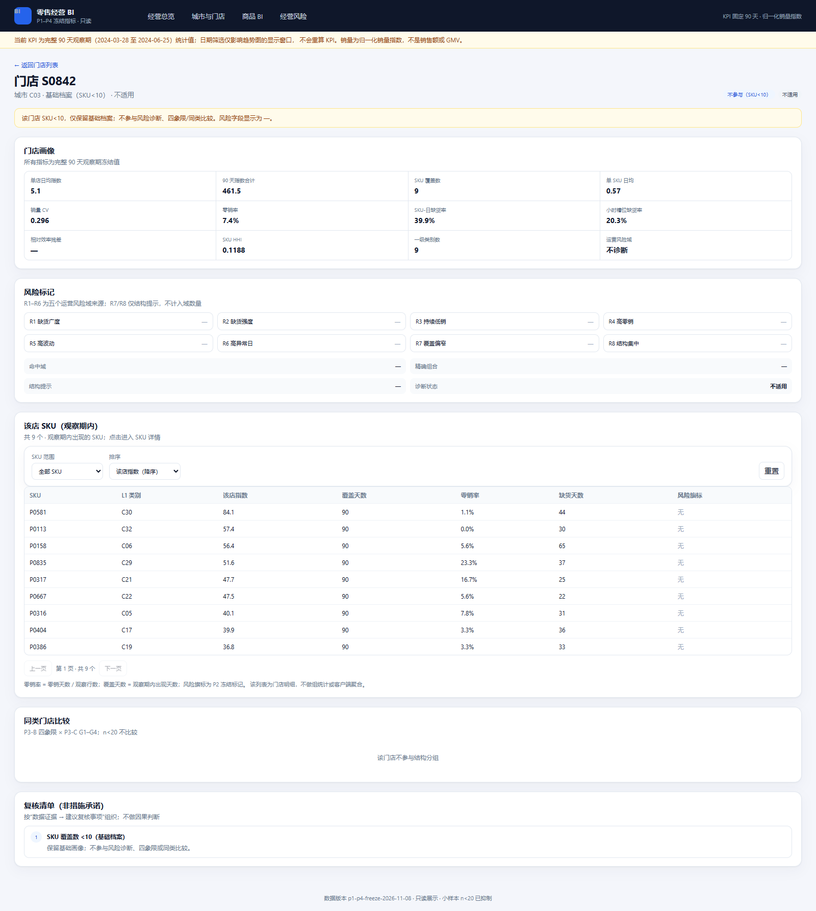
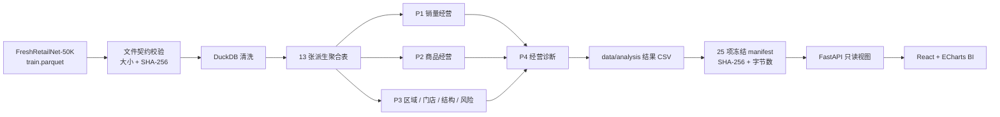

# FreshRetailNet 零售经营 BI

> 基于 FreshRetailNet-50K 的中国生鲜零售经营分析项目：先完成 P1–P4 四层经营分析并冻结结果，再在其上构建一套只读、可追溯、可下钻的本地 BI 网站。

[](https://www.python.org/)
[](https://fastapi.tiangolo.com/)
[](https://duckdb.org/)
[](https://react.dev/)
[](#测试)

---

## 项目背景

公开的中国零售数据里，很少有同时满足“真实业务、门店 × SKU × 日粒度、含缺货标注、许可清晰”的数据集。项目最终选用叮咚买菜发布的 **FreshRetailNet-50K**（CC BY 4.0），它有 898 家门店、18 个城市、865 个 SKU、50,000 条门店×商品 90 天序列，但**没有订单、用户、金额**，`sale_amount` 是全局归一化销量指数，不是销售额/GMV。

因此项目没有堆叠无法支撑的 GMV、复购、留存、利润指标，而是把范围收敛到四层可验证的经营分析：

1. **P1 销量经营**：90 天趋势、星期/小时结构、门店表现、异常日、持续低销；
2. **P2 商品经营**：SKU 规模/效率双榜、帕累托/长尾、类目结构、商品风险旗标；
3. **P3 区域、门店、结构、风险**：城市对比、门店分层、商品结构、缺货与风险组合；
4. **P4 经营诊断**：门店档案、诊断规则、SKU–门店覆盖、风险组合，并冻结为 25 项数据资产。

在冻结结果之上，项目实现了一套只读 BI：FastAPI + DuckDB 查询冻结 CSV/Parquet，React + ECharts 展示，支持筛选写入 URL、跨页面逐级下钻、多级返回和小样本抑制。

### 展示截图

| 经营总览 | 商品详情与下钻 |
|---|---|
|  |  |

| 城市与门店筛选 | 风险组合 |
|---|---|
|  |  |

---

## 核心功能

### 分析层（P1–P4）

| 阶段 | 能力 | 主要产物 |
|---|---|---|
| P1 销量经营 | 90 天日趋势、星期/小时分布、门店排行、异常日、持续低销 | `data/analysis/p1/`、`reports/figures/p1/` |
| P2 商品经营 | SKU 规模榜/效率榜、帕累托与长尾、L1–L3 类目、零销/CV/异常/集中度风险旗标 | `data/analysis/p2/`、`reports/figures/p2/` |
| P3A 城市 | 城市经营对比、城市相关性、城市结构 | `data/analysis/p3/`、`reports/figures/p3/` |
| P3B 门店分层 | 规模/效率、稳健回归、四象限、阈值敏感性 | `data/analysis/p3b/`、`reports/figures/p3b/` |
| P3C 商品结构 | HHI/熵、类目渗透、聚类、结构相似度 | `data/analysis/p3c/`、`reports/figures/p3c/` |
| P3D 缺货与风险 | 缺货两口径、R1–R8 风险旗标、精确组合/至少组合 | `data/analysis/p3d/`、`reports/figures/p3d/` |
| P4 诊断 | 门店档案、诊断规则、SKU–门店 incidence、风险画像 | `data/analysis/p4/`、`reports/figures/p4/` |

关键数据事实（已核验）：

- 训练集 4,500,000 行 × 19 列，观察期 2024-03-28 至 2024-06-25（90 天）；
- 898 家门店、18 个城市、865 个 SKU；
- 888 家门店进入风险诊断；117 个风险 SKU，其中 35 个多风险 SKU；
- 16 种“精确组合”、10 对“至少组合”；
- 风险旗标是筛查提示，不构成因果结论或经营评分。

### BI 层（BI-0 / BI-1 / BI-2）

| 阶段 | 实际完成内容 |
|---|---|
| BI-0 | 数据契约 + 只读访问层：25 项冻结文件 manifest、DuckDB 只读视图、FastAPI 契约、启动校验 |
| BI-1 | 第一批页面：经营总览、城市与门店、经营风险、门店详情；筛选状态写入 URL |
| BI-2 | 商品 BI：商品总览、列表、风险、分类、详情；跨页面状态与多级返回；精确/至少组合筛选；小样本抑制 |

前端路由（9 个页面）：

- `/overview` 经营总览
- `/cities-stores` 城市与门店
- `/stores/:storeId` 门店详情
- `/risk` 经营风险
- `/products` 商品总览
- `/products/list` 商品列表
- `/products/risk` 商品风险
- `/products/categories` 商品分类
- `/products/:productId` 商品详情

交互约束：

- 筛选条件写入 URL，刷新/返回可恢复；
- 城市 → 门店 → SKU → 商品支持逐级下钻和多级返回；
- 精确组合与至少组合是两套口径，不能相加或互相替代；
- `n<20` 的统计由后端置空并标记 `suppressed`，前端显示 `—`；
- `SKU<10` 的门店只保留基础档案，不进入风险诊断；
- API 只读，只允许 SELECT/CTE，禁用 DuckDB 外部访问和任意 SQL。

---

## 系统架构



数据边界：

- `data/raw/` 原始数据不随仓库分发；
- `data/derived/` 只提交聚合/诊断表，`clean_train.parquet`、`clean_eval.parquet` 可由原始数据重建；
- `data/analysis/` 提交 P1–P4 冻结结果，BI 和测试直接依赖；
- `eval.parquet` 存在但不参与分析和 BI，项目未读取 eval 结果。

---

## 技术栈

| 层次 | 技术 |
|---|---|
| 数据处理 | Python 3.13、pandas、NumPy、PyArrow、DuckDB |
| 统计分析 | SciPy、scikit-learn、statsmodels、Matplotlib |
| 后端 | FastAPI、Uvicorn、Pydantic v2、DuckDB 只读视图 |
| 前端 | React 18、TypeScript、Vite 6、React Router 6、ECharts 5 |
| 测试 | pytest、Vitest、Playwright（E2E 脚本） |
| 数据契约 | JSON manifest + SHA-256 + 字节数 + `.gitattributes` 字节保护 |

---

## 项目结构

```text
.
├─ README.md
├─ LICENSE
├─ NOTICE
├─ requirements.txt
├─ pytest.ini
├─ .gitignore
├─ .gitattributes
├─ src/freshretail/            # 数据管道、契约、P1–P4 分析
├─ scripts/                    # build_derived.py、run_p1..p4.py、数据核验
├─ tests/                      # 101 个 pytest 用例
├─ bi/
│  ├─ README.md
│  ├─ data/                    # freeze_manifest.json、指标字典、页面映射
│  ├─ src/bi_api/              # FastAPI + DuckDB 只读后端
│  ├─ tests/                   # 后端契约/API 测试
│  ├─ benchmarks/              # 只读性能基准
│  ├─ screenshots/             # 真实 UI / E2E 截图
│  └─ web/                     # React + TypeScript + Vite 前端
├─ data/
│  ├─ README.md                # 数据来源、下载、SHA、重建说明
│  ├─ analysis/                # P1–P4 冻结分析结果（提交）
│  ├─ derived/                 # 聚合/诊断表（提交；clean_* 不提交）
│  └─ verification/            # 原始数据核验摘要
├─ reports/figures/            # P1–P4 分析图
└─ docs/
   ├─ README.md                # 文档索引
   ├─ reports/                 # P1–P4 分析报告
   ├─ design/                  # 架构、数据契约、商品 BI、跨页联动设计
   ├─ project-review/          # 项目全景、架构、模块、问题、决策、测试
   ├─ project-story/           # 研发纪实
   ├─ project_development_guide/  # 66 个工作单元的研发指南
   └─ engineering-review.md    # 全生命周期复盘
```

---

## 数据来源与许可

- 数据集：**FreshRetailNet-50K**
- 发布方：Dingdong-Inc（叮咚买菜）
- 官方地址：<https://huggingface.co/datasets/Dingdong-Inc/FreshRetailNet-50K>
- 论文：<https://arxiv.org/abs/2505.16319>
- 许可证：**CC BY 4.0**（已通过 Hugging Face 数据集卡片核实）
- 原始数据不随本仓库分发；仓库只包含派生分析结果，并在 `NOTICE` 中保留署名与修改说明。

引用：

```text
Wang, Y., Gu, J., Long, L., Li, X., Shen, L., Fu, Z., Zhou, X., & Jiang, X. (2025).
FreshRetailNet-50K: A Stockout-Annotated Censored Demand Dataset for Latent Demand
Recovery and Forecasting in Fresh Retail. arXiv:2505.16319.
Dataset: https://huggingface.co/datasets/Dingdong-Inc/FreshRetailNet-50K (CC BY 4.0).
```

原始数据下载与校验详见 [data/README.md](data/README.md)。`scripts/build_derived.py` 会校验文件大小与 SHA-256，校验失败会拒绝继续。

仓库通过 `.gitattributes` 对 `data/**`、`bi/data/**` 和 `*.csv` 设置 `-text`，禁止 Git 对冻结文件做换行符转换；这样 Windows 工作区、GitHub ZIP 和 Linux/macOS 克隆得到的冻结文件字节一致，25 项 SHA-256 校验才能稳定通过。

---

## 环境要求

| 依赖 | 要求 | 本项目实测 |
|---|---|---|
| Python | 3.11+ | 3.13.9（Anaconda） |
| Node.js | 20+ | 24.16.0 |
| npm | 10+ | 11.13.0 |
| 操作系统 | Windows / macOS / Linux | Windows 11 |
| 浏览器 | Chrome / Chromium（仅 E2E） | Chrome 已安装 |

---

## 安装

### 1. Python 依赖

```powershell
python -m venv .venv
.\.venv\Scripts\Activate.ps1
python -m pip install --upgrade pip
pip install -r requirements.txt
```

macOS / Linux：

```bash
python3 -m venv .venv
source .venv/bin/activate
pip install -r requirements.txt
```

### 2. 前端依赖

```powershell
cd bi/web
npm ci
```

### 3. （可选）下载原始数据

仅运行 BI 和现有测试不需要原始数据。需要复现 P1–P4、重建派生表或运行 `requires_raw` / `requires_clean` 集成测试时，才需要下载：

```powershell
pip install huggingface_hub
hf download Dingdong-Inc/FreshRetailNet-50K --repo-type dataset --local-dir data/raw/freshretailnet50k
```

Hugging Face 会保留 `data/` 子目录。若文件位于 `data/raw/freshretailnet50k/data/train.parquet`，可设置：

```powershell
$env:FRESH_RETAIL_RAW_DIR = "data/raw/freshretailnet50k/data"
```

然后重建派生表并运行分析：

```powershell
python scripts/build_derived.py
python scripts/run_p1.py
python scripts/run_p2.py
python scripts/run_p3a.py
python scripts/run_p3b.py
python scripts/run_p3c.py
python scripts/run_p3d.py
python scripts/run_p4.py
```

`build_derived.py` 会校验 `train.parquet` 与 `eval.parquet` 的大小和 SHA-256；默认不使用 `--skip-hash`。

---

## 快速开始（只用仓库内冻结数据）

仓库已提交 BI 运行所需的 25 个冻结文件（约 5.34 MB）和 `data/analysis` 结果，因此**不下载原始数据也可以直接启动 BI**。

### 终端 1：启动后端

```powershell
$env:PYTHONPATH = "bi/src"
python -m uvicorn bi_api.main:app --host 127.0.0.1 --port 8000
```

健康检查：

```powershell
Invoke-WebRequest -UseBasicParsing http://127.0.0.1:8000/api/v1/health
```

预期：`status=ok`、`data_version=p1-p4-freeze-2026-11-08`。

### 终端 2：启动前端

```powershell
cd bi/web
npm run dev
```

浏览器打开：<http://127.0.0.1:5173/overview>

生产构建与预览：

```powershell
cd bi/web
npm run build
npm run preview
```

预览地址：<http://127.0.0.1:4173/>

### 启动失败时先检查

- 是否在仓库根目录启动后端；
- 是否设置了 `PYTHONPATH=bi/src`；
- `data/derived/agg_daily.parquet`、`agg_hour_profile.parquet`、`agg_hour_weekday.parquet` 是否存在；
- `bi/data/freeze_manifest.json` 是否完整；
- 8000 / 5173 端口是否被占用。

---

## 测试

### 后端

```powershell
# 同一命令会根据数据文件是否存在自动选择：
#   原始数据 + clean_train -> 101 passed
#   仅有 clean_train     -> 98 passed, 3 skipped
#   无 raw / 无 clean    -> 97 passed, 4 skipped（干净克隆的默认状态）
python -m pytest tests bi/tests -q

# 只跑完全不依赖 raw / clean 的基础测试（97 个）
python -m pytest -m "not requires_raw and not requires_clean" -q

# 下载原始数据后，只跑依赖原始数据的契约/抽样测试（3 个）
python -m pytest -m requires_raw -q

# 重建 data/derived/clean_train.parquet 后，只跑依赖清洗表的测试（1 个）
python -m pytest -m requires_clean -q
```

### 前端单元测试

```powershell
cd bi/web
npm test
```

### 冻结校验

```powershell
$env:PYTHONPATH = "bi/src"
python -c "from bi_api import freeze; print(freeze.verify_manifest())"
```

预期：`files_total=25`、`checked=25`。

### E2E（可选）

E2E 需要同时启动 API（8000）和前端 dev server（5173），并安装 Chrome/Chromium：

```powershell
cd bi/web
node tests/e2e.mjs
node tests/e2e-c1.mjs
node tests/e2e-c2.mjs
node tests/e2e-c3.mjs
node tests/e2e-c4.mjs
node tests/e2e-products.mjs
```

如果 Chrome 不在默认安装位置，设置：

```powershell
$env:CHROME_PATH = "C:\Path\To\chrome.exe"
```

当前测试状态（2026-11-13 实测）：

| 测试 | 结果 |
|---|---|
| pytest（原始数据 + clean_train） | 101 passed |
| pytest（仅有 clean_train） | 98 passed, 3 skipped |
| pytest（无 raw / 无 clean，干净克隆） | 97 passed, 4 skipped |
| Vitest | 23 passed（3 个文件） |
| 冻结校验 | 25/25 |
| E2E | 6 个脚本、56 个断言点；已在原始工作区和干净快照全部通过 |

---

## 核心技术设计与工程亮点

1. **口径纠偏**：`sale_amount` 是全局归一化销量指数，不是金额。项目在发现口径问题后全量修正文案、指标和 UI，避免把销量指数误讲成 GMV。
2. **冻结优先**：P1–P4 结果冻结为 25 个文件，manifest 记录 SHA-256 与字节数，API 启动即校验，失败拒绝启动。
3. **只读安全边界**：DuckDB `enable_external_access=false`，SQL 只允许 SELECT/CTE，关键词黑名单，视图只读。
4. **小样本保护**：`n<20` 的统计由后端抑制并标记 `suppressed`；`SKU<10` 的门店不进入风险诊断。
5. **两套组合口径**：精确组合与至少组合在 API、UI、测试中始终分列，不可相加。
6. **URL 即状态**：筛选写入 URL，多级下钻可逐级返回，`returnTo` 做路径安全校验。
7. **契约驱动测试**：数据文件大小/SHA、字段顺序/类型、主键唯一性、日期连续性都有测试或启动校验。

---

## 已知限制与技术债

- 本项目是**本地只读 BI**，不提供公网 Demo、登录、写入或权限体系；
- 数据只有 90 天，且没有订单/用户/金额，不能支持 GMV、复购、留存、利润分析；
- `eval.parquet` 不参与分析和 BI；
- E2E 需要本机 Chrome/Chromium，未纳入 CI；
- 截至 2026-11-13，`npm audit` 显示生产依赖 3 个 moderate（`echarts`、`react-router-dom` 及其间接依赖），开发工具链 6 个（2 critical、1 high、3 moderate）；本项目未在未验证兼容性的情况下盲目升级依赖，详见 `docs/engineering-review.md` 与技术债记录；
- 风险旗标、组合与多风险均为筛查提示，不构成因果结论或经营评分。

---

## 文档索引

| 文档 | 内容 |
|---|---|
| [docs/README.md](docs/README.md) | 文档总索引 |
| [docs/reports/](docs/reports/) | P1、P2、P3A、P3B、P3C、P3D、P4 分析报告 |
| [docs/design/](docs/design/) | BI 架构、数据契约、商品 BI、跨页联动设计 |
| [docs/project-review/](docs/project-review/) | 项目全景、架构、核心模块、问题与决策、测试 |
| [docs/project-story/](docs/project-story/) | 研发纪实（7 章） |
| [docs/project_development_guide/](docs/project_development_guide/) | 66 个工作单元的研发指南 |
| [docs/engineering-review.md](docs/engineering-review.md) | 全生命周期复盘 |
| [bi/README.md](bi/README.md) | BI 后端/前端运行与测试说明 |
| [data/README.md](data/README.md) | 数据来源、下载、校验与重建 |

---

## License

- 本项目代码：MIT，见 [LICENSE](LICENSE)；
- 数据集 FreshRetailNet-50K：CC BY 4.0，见 [NOTICE](NOTICE)；
- 原始数据不随仓库分发；派生分析结果的使用需保留数据集署名与许可声明。
