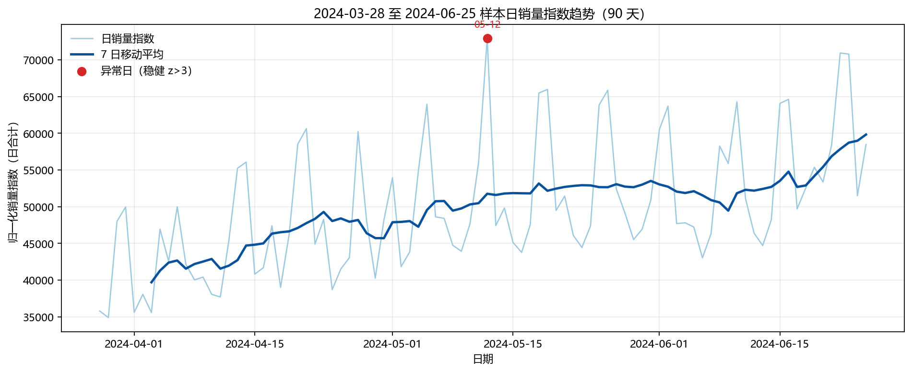
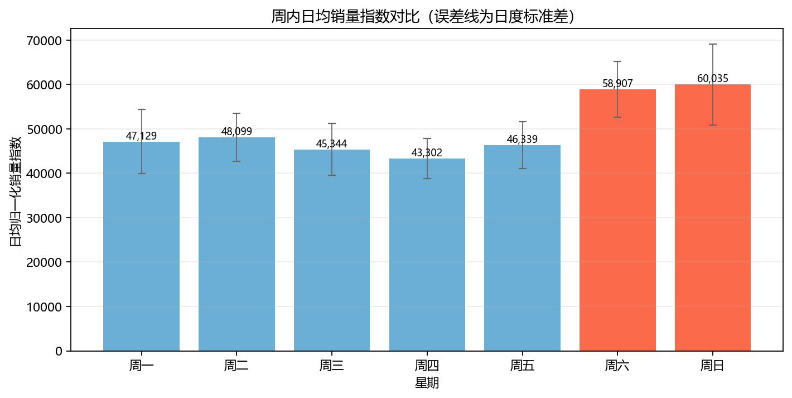
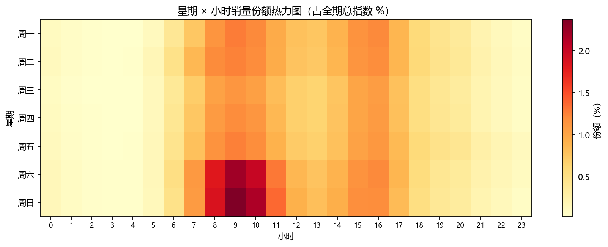
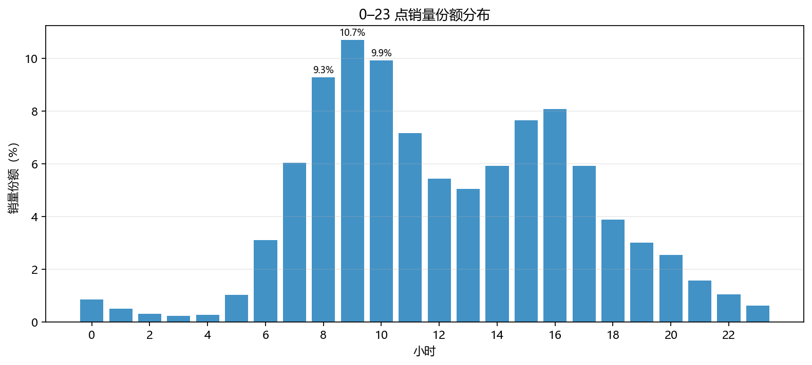
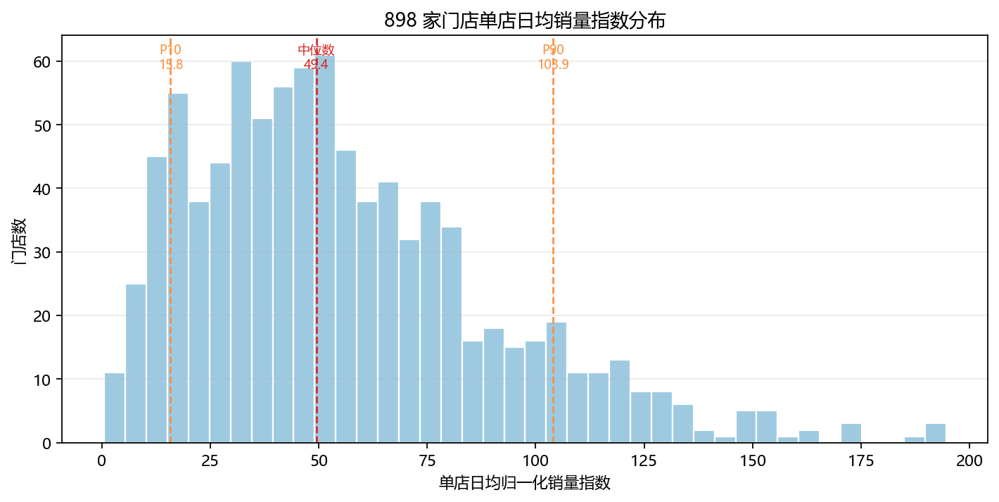
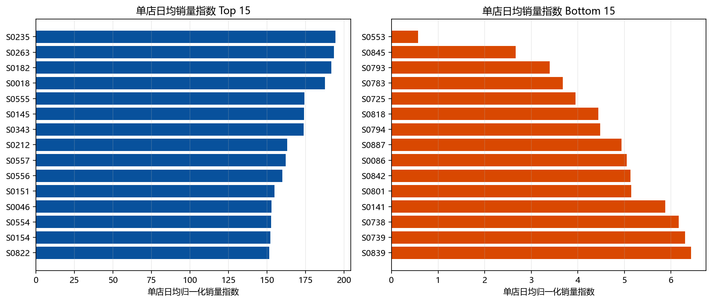
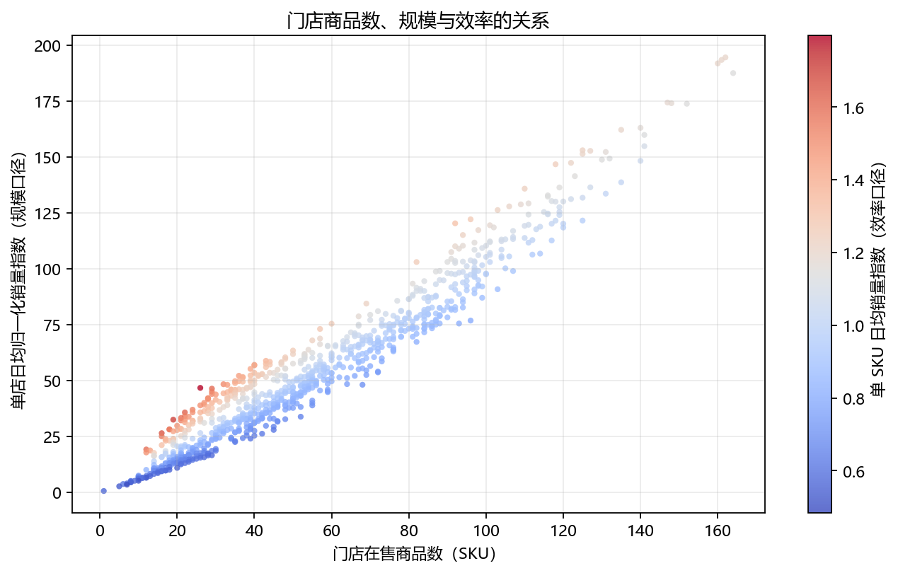
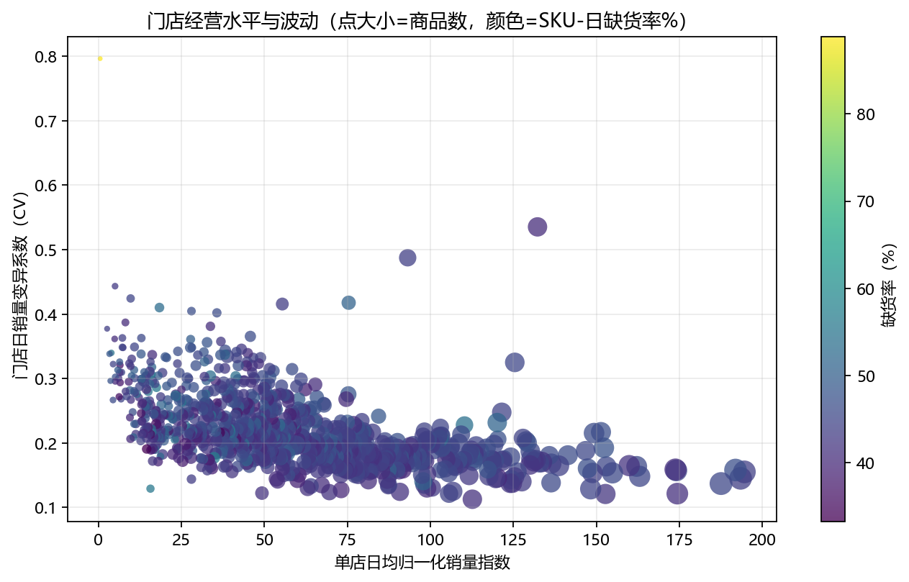
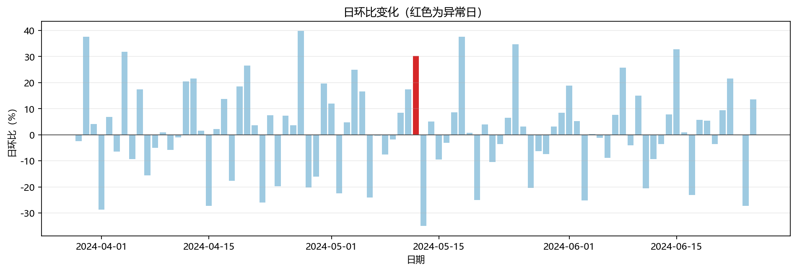

# 第七阶段 P1：销量经营状况分析报告

**项目**：中国数字零售与本地生活经营增长分析
**数据**：FreshRetailNet-50K（Dingdong-Inc，CC BY 4.0），仅使用 train 90 天
**分析范围**：模块一「销量经营状况」描述性分析
**日期**：2026-11-07

---

## 1. 分析目标与数据范围

### 1.1 目标

回答四个问题：
1. 样本销量指数在 90 天内如何变化，波动有多大；
2. 周内与日内存在什么稳定节律；
3. 898 家门店的经营水平与波动如何分布；
4. 哪些日期、哪些门店属于统计意义上的异常。

### 1.2 数据范围

| 项目 | 说明 |
|---|---|
| 数据源 | `data/derived/clean_train.parquet`（第六阶段生成）及 11 张派生表 |
| 时间 | 2024-03-28 至 2024-06-25，共 90 个连续自然日 |
| 规模 | 4,500,000 行；50,000 条门店×商品序列；898 家门店；865 个 SKU |
| 粒度 | 门店×商品×日；小时分析展开到 0–23 点 |
| 是否使用 eval | **否**。eval 仅保留给后续预测阶段一次性评估 |
| 金额类指标 | **全部不计算**（无金额字段） |

### 1.3 核心口径

- `sales_index` = `sale_amount` = **全局归一化销售数量（销量指数）**，非金额、非件数。
- 日总指数 = 当日 50,000 条序列的 `sales_index` 之和，仅代表**样本内**，不代表企业整体。
- 门店横向对比统一使用**单店日均**或**单 SKU 日均**，不使用门店总量。

---

## 2. 数据质量及使用口径

| 检查项 | 结果 |
|---|---|
| 行数 | 4,500,000（90 天 × 50,000 序列，完全平衡） |
| 空值 | 0 |
| 主键重复 | 0 |
| 日期连续性 | 90 个唯一日期，无缺失 |
| `sales_index` 值域 | 0 – 44.9，零值占 4.46% |
| 门店-日样本 | 80,820（898 × 90） |
| 派生表 | 11 张聚合表 + 4 张诊断表，均由第六阶段流水线生成 |

**指标口径说明（全部指标通用）**：

| 指标 | 公式 | 粒度 | 分母 |
|---|---|---|---|
| 样本日总销量指数 | Σ `sales_index` | 日 | — |
| 单店日均销量指数 | Σ `sales_index` / 门店-日数 | 门店 | 80,820 |
| 单 SKU 日均销量指数 | 单店日均 / 门店商品数 | 门店 | 门店×SKU×日 |
| 日波动率 CV | 日总指数的总体标准差 / 均值 | 日 | 90 天 |
| 周内日均 | 某星期所有日总指数的均值 | 星期 | 13 或 12 天 |
| 小时销量份额 | 某小时 Σ`hours_sale` / 全部 Σ`hours_sale` | 小时 | 全期 |
| SKU-日缺货率 | 缺货序列-日 / 全部序列-日 | 门店/城市 | 80,820 |

---

## 3. 整体销量趋势

### 3.1 水平与波动

| 指标 | 数值 |
|---|---|
| 90 天日总指数合计 | 4,493,660.8 |
| 日均 | 49,929.6 |
| 中位 | 47,997.9 |
| 日度 CV | **17.58%** |
| 最高日 | 2024-05-12（周日）72,938.8 |
| 最低日 | 2024-03-29（周五）34,893.5 |
| 峰谷比 | **2.09 倍** |

### 3.2 趋势

- 前 30 天均值 **44,106.2**，后 30 天均值 **53,984.5**，相差 **+22.40%**。
- 按自然周（周日至周六）汇总：首段 4 天（3/28–3/31）均值 42,156.6；随后 12 个完整周依次为 41,555.2 → 44,705.0 → 47,756.1 → 46,380.6 → 49,541.8 → 51,757.1 → 52,160.0 → 52,644.0 → 52,717.8 → 49,453.6 → 54,766.1 → 58,715.5；末段 2 天（6/24–6/25）54,982.3。
- 7 日移动平均从 4 月初约 4.2 万上升到 6 月下旬约 5.9 万。

**解释边界**：这 90 天覆盖春季到初夏，气温从 12.06°C 升至 30.88°C，并包含清明、劳动节、端午。**不能把 +22.40% 称为"增长"**，它同时包含季节、天气、节假日与趋势，本阶段没有识别设计可以拆分。

### 3.3 图形

图中浅蓝色为日指数，深蓝为 7 日移动平均，红点为稳健 z > 3 的异常日。可见明显的周内锯齿（周末高）与缓慢抬升的基线。

---

## 4. 周内经营规律

### 4.1 星期均值

| 星期 | 天数 | 日均指数 | 中位 | 标准差 | 相对全期均值 |
|---|---|---|---|---|---|
| 周一 | 13 | 47,129.0 | 47,696.9 | 7,250.5 | -5.61% |
| 周二 | 13 | 48,099.3 | 48,407.5 | 5,424.9 | -3.67% |
| 周三 | 12 | 45,344.2 | 45,802.1 | 5,847.9 | -9.18% |
| 周四 | 13 | **43,301.8** | 43,762.2 | 4,501.9 | **-13.27%** |
| 周五 | 13 | 46,338.8 | 46,315.5 | 5,291.8 | -7.19% |
| 周六 | 13 | 58,906.5 | 58,509.9 | 6,328.9 | +17.98% |
| 周日 | 13 | **60,034.7** | 63,687.4 | 9,126.1 | **+20.24%** |

- 工作日均值 **46,042.6**，周末均值 **59,470.6**，周末高出 **29.16%**。
- 周日最高、周四最低，峰谷差 **38.6%**（60,034.7 / 43,301.8 − 1）。
- 周日标准差最大（9,126），说明周日内部差异也最大。

### 4.2 `holiday_proxy` 辅助对比

| 口径 | 休息日代理=1 | 休息日代理=0 | 差异 |
|---|---|---|---|
| 全部日期 | 31 天 | 59 天 | 均值高 **26.88%** |
| 仅周一至周五 | 6 天 | 52 天 | 均值高 **6.86%** |

**关键判读**：全样本的 +26.88% 主要来自周末构成；把范围限制在工作日后，休息日代理只高 6.86%。由于 `holiday_flag` 的官方定义尚未明确（已提交 Issue #7），本报告只称"休息日代理"，不称"法定节假日"。

### 4.3 图形

---

## 5. 小时级经营规律

### 5.1 小时份额

| 时段 | 份额 | 累计 |
|---|---|---|
| 凌晨 0–5 | **3.15%** | 3.15% |
| 早市 6–8 | 18.42% | 21.57% |
| 上午 9–11 | **27.78%** | 49.35% |
| 午间 12–13 | 10.47% | 59.82% |
| 下午 14–16 | 21.64% | 81.45% |
| 傍晚 17–19 | 12.79% | 94.24% |
| 夜间 20–23 | 5.76% | 100.00% |

- 单小时峰值：**9 点 10.70%**、10 点 9.93%、8 点 9.28%；前三合计 **29.91%**，接近全天三分之一。
- 6–22 点合计 **96.24%**；22 点是 6–22 点区间内最低（1.05%）。
- 双峰结构明显：上午 8–10 点、下午 14–16 点。

### 5.2 星期 × 小时

热力图显示：周末的高峰更集中在上午 9–11 点与下午 15–17 点；工作日上午峰值相对平缓。

**注意**：以上均为**份额**，不是绝对规模；凌晨份额低既可能来自需求低，也可能来自门店未营业（`hours_stock_status` 在凌晨的高比例提示闭店），本阶段不做区分。

### 5.3 图形

---

## 6. 门店经营表现

### 6.1 规模口径分布

| 指标 | 数值 |
|---|---|
| 门店数 | 898 |
| 单店日均：中位 | 49.43 |
| P10 / P90 | 15.84 / 103.95 |
| P90/P10 | **6.56 倍** |
| 门店均值间 CV | 62.39% |
| Top 10% 门店贡献 | 23.02% |
| Top 20% 门店贡献 | 39.62% |

### 6.2 必须记录的口径问题：规模 ≠ 效率

`单店日均销量指数` 是门店全部 SKU 的加总，**与门店商品数高度相关**：

| 相关性（Spearman） | 数值 |
|---|---|
| 单店日均 vs 门店商品数 | **0.961** |
| 单 SKU 日均 vs 门店商品数 | 0.252 |
| 两种口径的门店排名相关 | **0.486** |

这意味着：**按"单店日均"排行，排在前面的主要是铺货最广的门店，而不是单品卖得最好的门店**。因此本报告同时给出两个口径：

| 口径 | 含义 | 适用 |
|---|---|---|
| 单店日均销量指数 | 门店整体规模 | 讨论门店体量、覆盖能力 |
| 单 SKU 日均销量指数 | 剥离商品数后的效率 | 讨论单品经营效率 |

**该问题未修改任何清洗规则**，只新增了一个分析指标 `per_sku_day_index = 单店日均 / 门店商品数`，并保留原指标。

### 6.3 两种口径的排行差异

| 排名 | 规模 Top5（单店日均） | 商品数 | 单 SKU 日均 |
|---|---|---|---|
| 1 | S0235 | 162 | 1.20 |
| 2 | S0263 | 161 | 1.20 |
| 3 | S0182 | 160 | 1.20 |
| 4 | S0018 | 164 | 1.14 |
| 5 | S0555 | 147 | 1.19 |

| 排名 | 效率 Top5（单 SKU 日均） | 商品数 | 单店日均 |
|---|---|---|---|
| 1 | S0356 | 26 | 1.80 |
| 2 | S0693 | 19 | 1.71 |
| 3 | S0791 | 16 | 1.65 |
| 4 | S0412 | 22 | 1.62 |
| 5 | S0869 | 29 | 1.60 |

- 规模 Top5 全部位于 city 0，商品数 147–164，单 SKU 日均约 1.1–1.2。
- 效率 Top5 商品数仅 16–29，单 SKU 日均 1.60–1.80。
- 规模 Bottom5 中 S0553 只有 1 个 SKU，缺货率 88.9%，单店日均 0.57 —— 属于极小品类样本，不能直接当作"经营差"的典型。

### 6.4 分层特征

**按规模（单店日均）四等分：**

| 分层 | 门店数 | 单店日中位 | 单 SKU 中位 | 商品数中位 | CV 中位 | 缺货率中位 | 促销率中位 |
|---|---|---|---|---|---|---|---|
| 最低 25% | 225 | 17.61 | 0.756 | 21 | 0.247 | 44.5% | 47.5% |
| 次低 25% | 224 | 39.97 | 0.925 | 40 | 0.230 | 44.3% | 50.9% |
| 次高 25% | 224 | 60.01 | 0.978 | 60.5 | 0.203 | 44.1% | 51.9% |
| 最高 25% | 225 | 98.05 | 1.042 | 95 | 0.178 | 44.3% | 52.1% |

**按效率（单 SKU 日均）四等分：**

| 分层 | 单 SKU 中位 | 单店日中位 | 商品数中位 | CV 中位 |
|---|---|---|---|---|
| 最低 25% | 0.735 | 19.19 | 27 | 0.234 |
| 次低 25% | 0.904 | 52.16 | 58 | 0.195 |
| 次高 25% | 1.015 | 75.13 | 75 | 0.195 |
| 最高 25% | 1.235 | 50.35 | 39 | 0.239 |

**可观察到的规律**：
1. 规模越高，商品数越多（21 → 95），CV 越低（0.247 → 0.178）；
2. 缺货率在四个规模层几乎不变（44.1%–44.5%），说明规模差异**不是**由缺货率差异解释的；
3. 促销率从 47.5% 升到 52.1%，幅度很小；
4. 效率最高的 25% 门店并不是规模最大的，其商品数中位 39、单店日中位 50.35，低于次高层的 75.13 —— 存在**规模与效率的取舍**。

---

## 7. 异常识别结果

### 7.1 判定规则（先定规则，再看结果）

| 对象 | 规则 | 阈值 |
|---|---|---|
| 日度异常 | 对日总指数计算稳健 z = (x − 中位) / (1.4826 × MAD) | \|z\| > 3 |
| 门店截面异常 | 对 898 个单店日均计算稳健 z | \|z\| > 3 |
| 门店-日异常 | 对每家门店自身 90 天日指数计算稳健 z | \|z\| > 3 |
| 持续低销 | 7 日滚动均值 < 该店 90 天中位数的 70%，且连续 ≥ 7 天 | 70% / 7 天 / 7 天 |

### 7.2 结果

| 类型 | 数量 | 说明 |
|---|---|---|
| 日度异常 | **1 天** | 2024-05-12 |
| 门店截面高异常 | **20 家** | 全部为"极高"，全部位于 city 0 |
| 门店截面低异常 | **0 家** | 稳健 z 规则在右偏分布下不触发低侧，需改用 P10 口径 |
| 门店-日异常 | **1,354 条**（533 家门店） | 占 80,820 个门店-日的 1.68% |
| 其中正向/负向 | 1,323 / 31 | 绝大多数是向上尖峰 |
| 持续低销门店 | **92 家**（10.2%） | 最长连续低销 26 天 |

### 7.3 异常日详情

**2024-05-12（周日）**：日指数 72,938.8，稳健 z = 3.26，日环比 +30.23%。
- 当日 `holiday_proxy = 1`；
- `activity_flag` 覆盖率 44.16%，高于 90 天均值 37.84%；
- 促销覆盖率 55.40%，高于均值 51.53%；
- 销量指数最高的 5 天全部为休息日代理=1，说明周内节律是主要解释，活动/促销只是弱伴随证据。
- 该日为母亲节（外部日历事实），但数据中没有可直接验证的节日营销字段，**不作因果解释**。

### 7.4 门店异常详情

- 20 家截面高异常门店：单店日均 146.7–194.6，商品数 118–164，全部在 city 0。其高值主要来自商品数多，与 6.2 节的规模混淆一致。
- 门店-日异常以正向为主（1,323 vs 31），说明大多数"异常"是单日冲高，而非塌陷；负向异常仅 31 条，值得在 P2/P3 中核查是否为缺货或数据问题。
- 92 家持续低销门店：最长连续 26 天，建议作为后续商品结构与区域诊断的优先样本，但本阶段不下结论。

---

## 8. 图表及业务解释

| 编号 | 文件 | 图表类型 | X / Y | 粒度 | 业务解释 |
|---|---|---|---|---|---|
| F1 | `f1_daily_trend.png` | 折线 + 移动平均 | 日期 / 日总指数 | 日 | 周内锯齿明显，基线缓慢抬升 |
| F2 | `f2_weekday.png` | 柱状 + 误差线 | 星期 / 日均指数 | 星期 | 周日最高、周四最低，周末高出 29.2% |
| F3 | `f3_hour_share.png` | 柱状 | 小时 / 份额% | 小时 | 8–10 点与 14–16 点双峰，前三小时占 29.9% |
| F4 | `f4_weekday_hour_heatmap.png` | 热力图 | 星期 × 小时 / 份额% | 星期×小时 | 周末上午与下午高峰更集中 |
| F5 | `f5_store_distribution.png` | 直方图 | 单店日均 / 门店数 | 门店 | 右偏分布，P90/P10 = 6.56 |
| F6 | `f6_store_ranking.png` | 条形图 | 门店 / 单店日均 | 门店 | Top15 与 Bottom15，需结合商品数解读 |
| F7 | `f7_daily_change.png` | 柱状 | 日期 / 日环比% | 日 | 红色为异常日，5/12 环比 +30.2% |
| F8 | `f8_store_scatter.png` | 散点 | 单店日均 / CV | 门店 | 规模越大，波动越低（描述性） |
| F9 | `f9_store_breadth_vs_scale.png` | 散点 | 商品数 / 单店日均 | 门店 | 规模与商品数高度同向，颜色显示效率差异 |

所有图的 Y 轴均为"归一化销量指数"或"份额（%）"，不含金额单位。

---

## 9. 核心发现与经营建议

### 9.1 核心发现

1. **周内节律是最稳定的结构**：周末比工作日高 29.16%，周日比周四高 38.6%，且销量最高的 5 天全部为休息日代理。
2. **日内双峰明确**：9 点（10.70%）、10 点（9.93%）、8 点（9.28%）合计 29.91%；6–22 点覆盖 96.24% 的销量指数。
3. **90 天整体抬升 +22.40%，但不能称为增长**：春→夏的季节与天气变化未剥离，且没有对照组。
4. **门店规模差异主要来自商品数**：单店日均与商品数的 Spearman 为 0.961；两种口径的排名相关仅 0.486。
5. **规模越大，波动越小**：CV 中位从最低层的 0.247 降到最高层的 0.178。
6. **缺货率在规模分层间几乎持平**（44.1%–44.5%），说明规模差异不能用缺货解释。
7. **异常以向上尖峰为主**：1,354 条门店-日异常中 1,323 条为正向；持续低销门店 92 家。
8. **集中度中等**：Top 10% 门店贡献 23.02%，Top 20% 贡献 39.62%，不属于高度集中。

### 9.2 经营建议（仅基于本阶段证据，不含因果承诺）

| # | 建议 | 证据 | 监测指标 |
|---|---|---|---|
| 1 | 按周内节律排班与备货：周五晚至周日为高峰，周四为低谷 | 周末 +29.16%，周日/周四差 38.6% | 周末 uplift、周内峰谷比 |
| 2 | 在 8–10 点、14–16 点前完成补货与上架 | 两个时段合计 51.54% | 高峰时段缺货率、上架及时率 |
| 3 | 门店评估同时看规模与效率，避免只奖励铺货 | 两口径排名相关 0.486 | 单店日均、单 SKU 日均 |
| 4 | 对 92 家持续低销门店做专项排查（商品结构、缺货、位置），先诊断后动作 | 10.2% 门店存在 ≥7 天连续低销 | 持续低销门店数、恢复率 |
| 5 | 对 20 家规模异常门店核查是否为"商品数驱动"的高产出 | 商品数 118–164，全部 city 0 | 单 SKU 日均、商品数 |
| 6 | 把 5/12 类高峰日作为运营预案样本，不宣称活动带来增长 | 当日 +30.2%，但与周日重合 | 高峰日销量、缺货率、促销覆盖 |

---

## 10. 数据限制和无法回答的问题

| # | 限制 | 导致无法回答 |
|---|---|---|
| 1 | 无金额字段 | GMV、销售额、客单价、利润、ROI |
| 2 | 无用户 ID、无订单 ID | 新老用户、RFM、复购、留存、Cohort |
| 3 | 仅 90 天 | 同比、完整季度、年度趋势、长期季节性 |
| 4 | 城市/门店/商品/类目匿名 | 真实城市、门店名、商品名、品牌、价格带 |
| 5 | 归一化系数未公开 | 绝对销量规模、企业整体销量 |
| 6 | 无成本与价格 | 毛利、价格弹性、促销 ROI |
| 7 | `holiday_flag` 定义未确认 | "法定节假日"效应（当前只能称休息日代理） |
| 8 | `activity_flag` 语义未确认 | 活动效果归因 |
| 9 | 天气单位未标注 | 天气的物理解释（只能做相对分箱） |
| 10 | 观察性数据 | 任何因果结论（促销、缺货、天气、活动） |
| 11 | 抽样 50k 序列 | 外推到叮咚整体或行业 |
| 12 | 门店规模与商品数高度共线 | 无法用本数据单独识别"经营效率"的因果因素 |

---

## 11. 实际新增文件及运行验证结果

### 11.1 新增文件

| 类别 | 文件 |
|---|---|
| 分析代码 | `src/freshretail/analysis/__init__.py`、`src/freshretail/analysis/p1.py` |
| 运行入口 | `scripts/run_p1.py` |
| 结果表（12 个 CSV + 1 JSON） | `data/analysis/p1/t1_daily.csv` ~ `t12_store_efficiency_quartile.csv`、`summary.json` |
| 图表（9 张 PNG） | `reports/figures/p1/f1_daily_trend.png` ~ `f9_store_breadth_vs_scale.png` |
| 版本管理 | `.gitignore`；已初始化 `.git`（此前不存在） |
| 本报告 | `07_第七阶段P1销量经营状况分析报告.md` |

### 11.2 结果表清单

| 文件 | 内容 | 行数 |
|---|---|---|
| `t1_daily.csv` | 日度趋势、MA7、环比、稳健 z | 90 |
| `t2_weekday.csv` | 星期汇总 | 7 |
| `t3_hour.csv` | 小时份额 | 24 |
| `t4_period.csv` | 时段份额 | 7 |
| `t5_weekday_hour.csv` | 星期×小时矩阵 | 7×24 |
| `t6_store.csv` | 门店双口径指标 | 898 |
| `t7_store_quartile.csv` | 规模四等分画像 | 4 |
| `t8_anomaly_days.csv` | 异常日 | 1 |
| `t9_store_cross_anomaly.csv` | 截面异常门店 | 20 |
| `t10_store_day_anomaly.csv` | 门店-日异常 | 1,354 |
| `t11_sustained_low.csv` | 持续低销门店 | 92 |
| `t12_store_efficiency_quartile.csv` | 效率四等分画像 | 4 |

### 11.3 运行验证

| 项目 | 结果 |
|---|---|
| 分析运行 | `python scripts/run_p1.py` 成功运行（含 9 张图生成） |
| 图表生成 | 9 张，均非空（33 KB – 195 KB） |
| 中文字体 | Microsoft YaHei 正常渲染，无方框 |
| 单元测试 | **18 passed in 1.56s** |
| 原始数据 | 未修改 |
| eval | 未读取、未使用 |
| 前六阶段报告 | 未修改 |
| Git | 已初始化；`.gitignore` 排除原始/派生 Parquet 与运行日志；**未提交** |

### 11.4 数据集作者沟通

- 已核查官方 README、Hugging Face 数据卡、GitHub Issues 与 HF Discussions；
- 现有 Issue #6 的维护者回复确认：`sale_amount` 表示销量，因保密限制不提供销售额或单价信息；
- 现有 Issue #5 与 SKU 数量讨论（HF Discussion #2）未涉及本次问题；
- 已提交英文 Issue：**https://github.com/Dingdong-Inc/frn-50k-baseline/issues/7**
  询问 `holiday_flag` 是否包含周末、`activity_flag` 的业务含义与粒度、四个天气字段的单位；
- 该事项不阻塞后续分析。

---

## 附录：执行边界声明

- 本阶段只完成 P1，未执行 P2–P6；
- 未修改原始 `train.parquet` / `eval.parquet`；
- 未修改第六阶段的清洗规则与指标目录；
- 仅新增一个分析口径指标 `per_sku_day_index`，原指标与原始字段保持不变；
- 未使用 eval 进行探索、筛选或阈值设置；
- 所有结论均为描述性，不构成因果结论。
