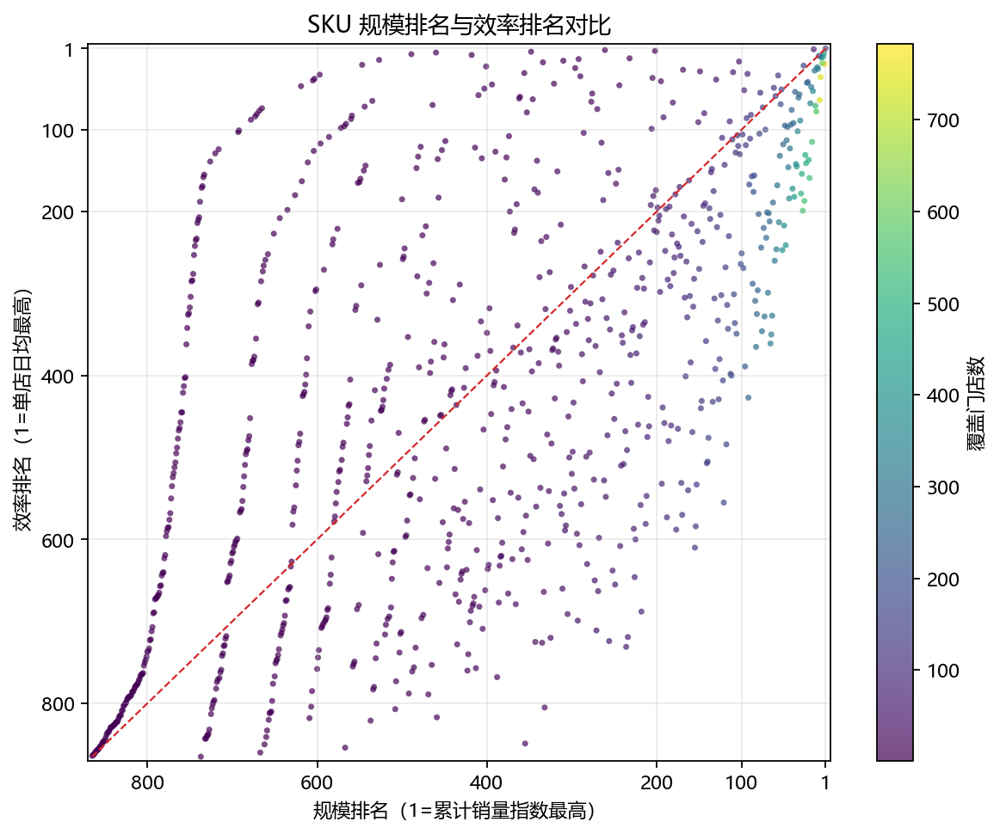
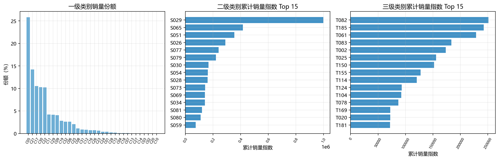
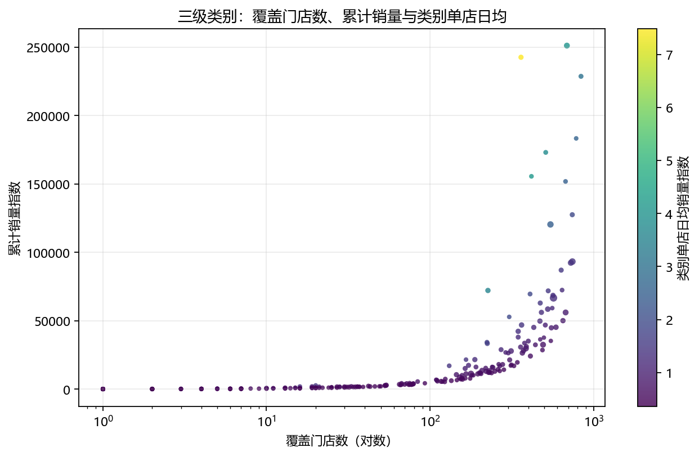
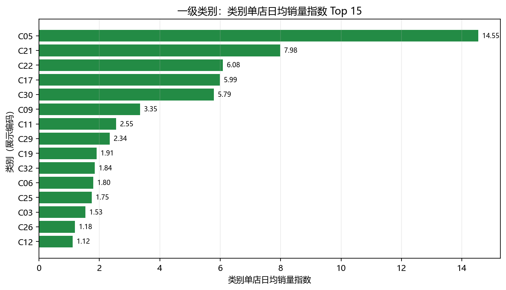
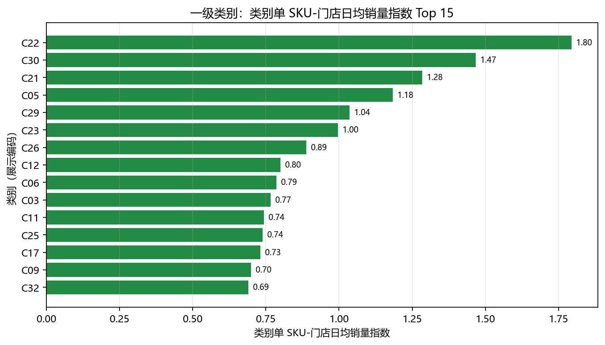
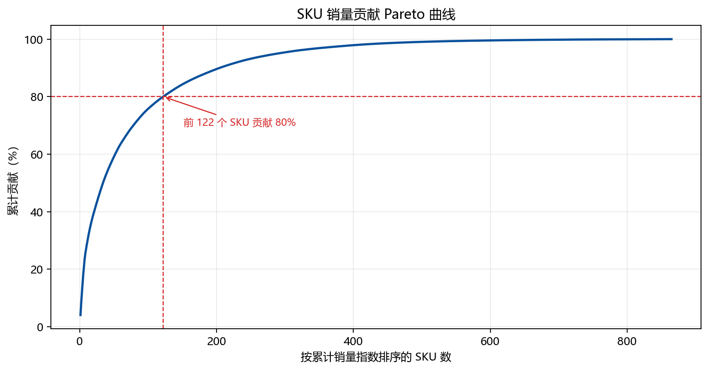
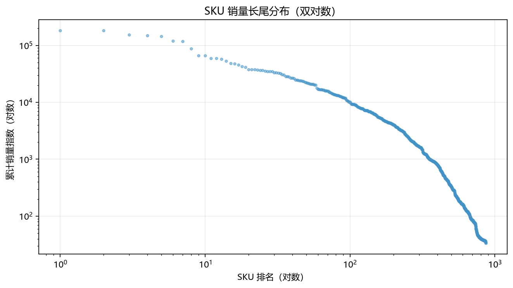
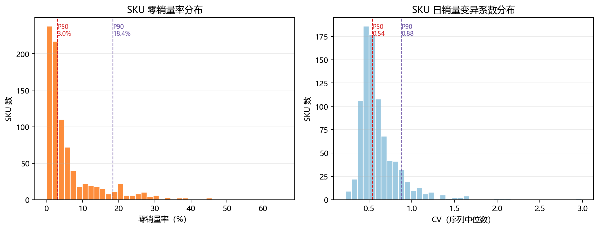
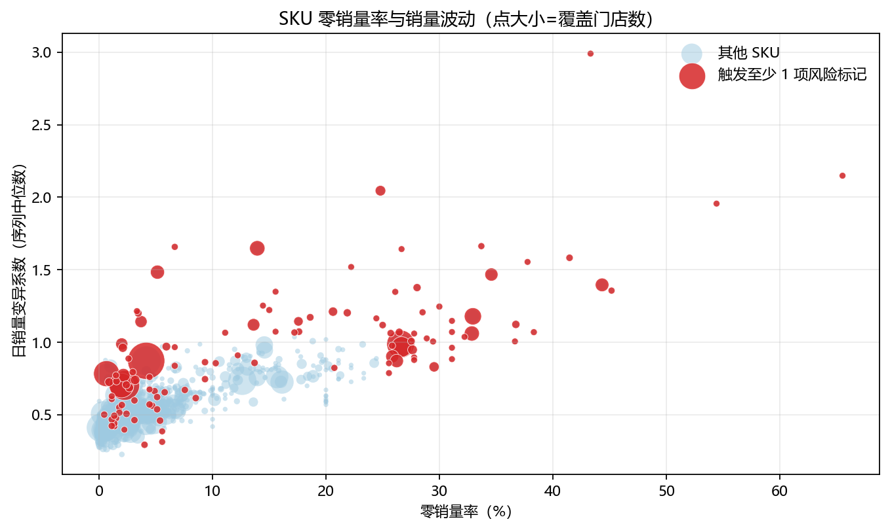

# 第七阶段 P2：商品经营分析报告

**项目**：中国数字零售与本地生活经营增长分析
**数据**：FreshRetailNet-50K（Dingdong-Inc，CC BY 4.0），仅使用 train 90 天
**分析范围**：模块四「商品经营分析」
**日期**：2026-11-08

---

## 1. 分析目标与数据范围

### 1.1 目标

1. 识别累计销量指数贡献高的 SKU；
2. 识别在已覆盖门店中平均表现更好的 SKU；
3. 比较一级、二级、三级类别的表现；
4. 判断头部集中与长尾程度；
5. 比较 SKU 的稳定性、零销量与需求波动；
6. 检查覆盖门店数对排名的影响；
7. 识别高波动或异常 SKU。

### 1.2 数据范围

| 项目 | 说明 |
|---|---|
| 数据源 | `data/derived/clean_train.parquet` + `agg_product_summary.parquet` |
| 时间 | 2024-03-28 至 2024-06-25，90 天 |
| 规模 | 4,500,000 行；865 个 SKU；50,000 条门店×SKU 序列 |
| 粒度 | 门店×SKU×日 |
| eval | **未读取** |
| 金额 | **不涉及**；全部为归一化销量指数 |

### 1.3 展示编码

- 商品：`P0001`–`P0865`（按原始 `product_id` 升序）
- 一级类别：`C01`–`C32`
- 二级类别：`S001`–`S084`
- 三级类别：`T001`–`T233`

原始 ID 与展示编码的映射分别保存在 `map_product.csv`、`map_l1.csv`、`map_l2.csv`、`map_l3.csv`。**没有虚构任何类别名称或商品名称。**

---

## 2. 口径、覆盖与样本量处理

### 2.1 双口径定义

| 口径 | 公式 | 分母 | 说明 |
|---|---|---|---|
| 规模 | Σ `sales_index` | — | 累计销量指数，受覆盖门店数影响 |
| 效率 | 总指数 / 序列-日数 | 门店-SKU-日 | 等价于"单店日均销量指数" |
| 覆盖 | `COUNT(DISTINCT store_id)` | — | 必须与上述两个指标同时报告 |
| 观察天数 | `COUNT(*)` | — | 每个 SKU 的序列-日数 |
| 零销率 | 零销序列-日 / 序列-日 | 序列-日 | 非"零需求" |
| 波动 | 每个序列的 CV 取中位数 | 序列 | 避免跨店结构影响 |

经核对：`per_series_day = total_index / (store_count × 90)` 与 `per_store_day` 完全相等（最大差 0.0），因此两者在报告中视为同一效率口径。

### 2.2 覆盖分布（本阶段的核心约束）

| 指标 | 数值 |
|---|---|
| 覆盖门店数中位 | **10** |
| 均值 | 57.8 |
| P10 / P90 | 1 / 173.6 |
| 最大 | 783 |
| 仅 1 家门店 | 150 个 SKU（17.3%） |
| ≤ 2 家门店 | **230 个（26.6%）** |
| ≤ 5 家门店 | **346 个（40.0%）** |

**处理原则**：
1. 规模排行同时标注覆盖门店数；
2. 效率主榜使用**经验性门槛：覆盖门店数 ≥ 5**（540 个 SKU），同时提供全量榜；该门槛不是统计最优值；
3. 不删除任何低覆盖 SKU，只做门槛敏感性比较；
4. 所有门槛结果见 `t7_coverage_sensitivity.csv`。

### 2.3 门槛敏感性

| 最低覆盖 | SKU 数 | 中位覆盖 | 规模-效率排名相关 | 效率 Top10 与全量榜重合 | 效率 Top10 平均覆盖 |
|---|---|---|---|---|---|
| 1（全量） | 865 | 10 | 0.598 | 10 | 80.1 |
| 2 | 715 | 19 | 0.589 | 8 | 162.9 |
| 3 | 635 | 26 | 0.622 | 6 | 164.1 |
| **5** | **540** | **37** | **0.601** | **5** | **164.4** |
| 10 | 443 | 61 | 0.671 | 4 | 305.9 |
| 20 | 356 | 81 | 0.715 | 4 | 322.2 |
| 50 | 241 | 126 | 0.732 | 4 | 349.0 |
| 100 | 153 | 185 | 0.783 | 3 | 379.7 |

**结论**：门槛越高，效率榜越向"广泛铺货"的 SKU 靠拢，与全量榜的重合从 10 降到 3。**任何效率排行都必须声明覆盖门槛，否则不可比。**

---

## 3. SKU 双口径分析

### 3.1 规模口径 Top 10

| 排名 | SKU | 累计指数 | 覆盖门店 | 单店日均 | 零销率 | CV 中位 |
|---|---|---|---|---|---|---|
| 1 | P0268 | 183,395.1 | 131 | 15.56 | 3.10% | 0.613 |
| 2 | P0005 | 183,265.3 | **783** | 2.60 | 4.15% | 0.872 |
| 3 | P0301 | 154,505.6 | 412 | 4.17 | 2.56% | 0.412 |
| 4 | P0118 | 150,032.9 | 459 | 3.63 | 2.76% | 0.383 |
| 5 | P0216 | 144,031.1 | 614 | 2.61 | 4.84% | 0.455 |
| 6 | P0071 | 120,042.1 | 371 | 3.60 | 2.21% | 0.380 |
| 7 | P0581 | 117,250.9 | 735 | 1.77 | 0.14% | 0.410 |
| 8 | P0835 | 87,215.5 | 741 | 1.31 | 12.62% | 0.734 |

- 规模 Top20 平均覆盖 **434.1 家**；
- 规模 Top10 平均覆盖 **479.5 家**；
- 规模与覆盖门店数的 Spearman = **0.978**。

### 3.2 效率口径 Top 10（覆盖 ≥ 5）

| 排名 | SKU | 单店日均 | 覆盖门店 | 累计指数 | 零销率 |
|---|---|---|---|---|---|
| 1 | P0268 | 15.56 | 131 | 183,395.1 | 3.10% |
| 2 | P0590 | 10.79 | 50 | 48,568.1 | 0.09% |
| 3 | P0757 | 6.33 | 7 | 3,990.4 | 7.30% |
| 4 | P0301 | 4.17 | 412 | 154,505.6 | 2.56% |
| 5 | P0692 | 3.85 | 192 | 66,486.6 | 1.37% |
| 6 | P0118 | 3.63 | 459 | 150,032.9 | 2.76% |
| 7 | P0071 | 3.60 | 371 | 120,042.1 | 2.21% |
| 8 | P0414 | 3.42 | 10 | 3,076.1 | 2.00% |

- 效率 Top20 平均覆盖 **213.0 家**，明显低于规模 Top20 的 434.1；
- 效率榜中仍有 P0757（7 家）、P0414（10 家）等低覆盖 SKU，需结合门槛解读。

### 3.3 两套排行的差异

| 指标 | 数值 |
|---|---|
| 规模排名 vs 效率排名 Spearman | **0.598** |
| 累计指数 vs 覆盖门店数 Spearman | **0.978** |
| 累计指数 vs 单店日均 Spearman | 0.598 |
| 规模 Top20 平均覆盖 | 434.1 |
| 效率 Top20 平均覆盖 | 213.0 |

**关键判断**：
- 规模排名几乎由覆盖门店数决定（0.978），**高销量商品主要依赖更广泛的门店覆盖**；
- 效率排名与规模排名只有中等相关（0.598），说明"卖得多"和"在店里卖得好"不是同一件事；
- P0005 是典型案例：覆盖 783 家门店、累计指数第 2，但单店日均只有 2.60，未进入效率 Top10（第 10 名约 2.94）；P0268 覆盖仅 131 家，但单店日均 15.56，规模与效率同时第一。

---

## 4. 商品类别分析

> **口径修正说明（2026-11-08）**：专项审计发现，原指标"类别单店日均"的实际分母是 SKU-门店-日记录数。本版保留原计算并改名为 `category_sku_store_day_avg`（类别单 SKU-门店日均），同时新增真正的 `category_store_day_avg`（类别单店日均）。两者含义不同，不能混用。

### 4.1 类别指标口径

| 指标 | 计算对象 | 分子 | 分母 | 汇总方式 |
|---|---|---|---|---|
| `category_store_day_avg` | 类别覆盖门店的日均销量指数 | 类别累计销量指数 | **去重门店-日数** `COUNT(DISTINCT store_id, dt)` | 按门店-日直接汇总；平衡面板下等于门店数×90 |
| `category_sku_store_day_avg` | 类别内单个 SKU 在单店的日均 | 类别累计销量指数 | **SKU-门店-日记录数** | 按 SKU-门店-日加权，等价于类内 SKU 单店日均的加权平均 |
| `sku_store_day_zero_rate` | SKU-门店-日层面的零销比例 | 零销 SKU-门店-日 | 全部 SKU-门店-日 | 直接汇总；**不是门店零销率** |
| `sku_store_day_promo_rate` | SKU-门店-日层面的促销比例 | 促销 SKU-门店-日 | 全部 SKU-门店-日 | 直接汇总 |
| `sku_cv_median` | 类别内 SKU 的波动中位 | — | — | 先算每条门店×SKU 序列的 CV，取 SKU 中位，再取类别内 SKU 中位（双重中位） |
| `observed_days_avg` | 平均观察天数 | — | — | `store_days / store_count`，当前为 90 天；由数据动态计算，不写死 |

**业务含义**：
- `category_store_day_avg` 回答"这个类别在一家门店一天平均卖多少"，适合门店运营与品类贡献；
- `category_sku_store_day_avg` 回答"这个类别里单个 SKU 在单店平均卖多少"，适合选品与单品效率；
- 两者受类内 SKU 数影响方向相反：SKU 越多，门店-日口径越大、单 SKU 口径越容易被摊薄。

### 4.2 一级类别（32 个）

| 类别 | SKU 数 | 覆盖门店 | 份额 | 单 SKU-门店日均（排名） | 单店日均（排名） | 零销率 | 促销率 | CV 中位 |
|---|---|---|---|---|---|---|---|---|
| C05 | 95 | 886 | **25.81%** | 1.184（4） | **14.545（1）** | 4.62% | 51.62% | 0.526 |
| C21 | 75 | 890 | 14.23% | 1.284（3） | 7.984（2） | 5.44% | 58.17% | 0.527 |
| C17 | 90 | 876 | 10.51% | 0.731（13） | 5.991（4） | **0.80%** | 60.18% | 0.441 |
| C30 | 10 | 886 | 10.27% | 1.467（2） | 5.789（5） | 2.09% | 58.81% | 0.683 |
| C22 | 62 | 839 | 10.22% | **1.795（1）** | 6.083（3） | 3.38% | 36.27% | 0.515 |
| C11 | 48 | 827 | 4.22% | 0.743（11） | 2.550（7） | 9.30% | 40.24% | 0.531 |
| C29 | 34 | 883 | 4.15% | 1.036（5） | 2.344（8） | 12.77% | 42.24% | 0.808 |

- 前 3 类合计 **50.52%**，前 5 类合计 **71.04%**。
- **C05**：规模第 1，单店日均 **14.545（第 1）**，但单 SKU-门店日均 1.184（第 4）。它是"门店产出最高、单品平均效率中等"的类别，不能称为低单产。
- **C22**：单 SKU-门店日均 **1.795（第 1）**，但单店日均 6.083（第 3）。它是"单品效率最高、门店总产出不是最高"的类别。
- **C21**：单店日均 7.984（第 2），单 SKU 1.284（第 3），规模与效率较均衡。
- **C17**：零销率仅 0.80%，单店日均 5.991（第 4），但单 SKU 仅 0.731（第 13）——铺得广、卖得稳、单品平均弱。
- **C30**：仅 10 个 SKU，单 SKU 效率第 2（1.467），单店日均为第 5（5.789）。
- **C29**：零销率 12.77%、CV 0.808，属于高波动类。

### 4.3 二级类别（84 个）

- 前 5 类合计 **51.17%**。
- **S029**：份额 **22.20%**（第 1），77 个 SKU、874 家门店；单店日均 **12.681（第 1）**，单 SKU-门店日均 1.319（第 5）——规模与门店产出最高，单品效率中等。
- **S065**：份额 9.28%，46 个 SKU、805 家门店；单店日均 5.754（第 2），单 SKU-门店日均 **2.318（第 1）**——单品效率最高。
- **S079**：仅 3 个 SKU、840 家门店，份额 4.92%，单店日均 2.923，促销率 **72.79%**、CV 0.872——高覆盖、高促销、高波动。

### 4.4 三级类别（233 个）

- 前 5 类合计 **24.01%**，集中度明显低于一级与二级。
- **T185**：仅 **7 个 SKU**、360 家门店，份额 5.40%；单店日均 **7.490（第 1）**、单 SKU-门店日均 **7.367（第 1）**、促销率 **5.21%**、CV 0.457——两种口径都领先，且几乎不依赖促销，值得专题研究。
- **T082**：13 个 SKU、687 家门店，份额 5.59%；单店日均 4.063（第 3）、单 SKU-门店日均 1.851（第 8）、促销率 30.92%。
- **T061**：5 个 SKU、838 家门店，份额 5.09%；单店日均 3.033（第 6）、单 SKU-门店日均 1.263（第 19）、零销率 0.55%。
- **T083**：仅 2 个 SKU、783 家门店，份额 4.08%；单店日均 2.602（第 7）、单 SKU-门店日均 2.598（第 5）、促销率 **95.53%**、CV **1.110**——高覆盖、几乎全促销、高波动。

---

## 5. 集中度与长尾

| 指标 | 数值 |
|---|---|
| SKU 总数 | 865 |
| Top 10% SKU 贡献 | **72.30%**（按向下取整为 86 个 SKU，占 9.94%） |
| Top 20% SKU 贡献 | **87.00%** |
| 贡献 80% 所需 SKU | **122 个（14.1%）** |
| 长尾 Bottom 50% 覆盖门店中位 | 2 家 |

**解读**：
- 头部集中明显但不是极端垄断：122 个 SKU 贡献 80%，其余 743 个合计 20%；
- 长尾 SKU 的覆盖门店中位只有 2 家，**其低销量很大程度上是"没铺开"**，不能直接判定为"商品差"；
- 因此规模榜必须与覆盖门店数并列展示，效率榜必须设门槛。

---

## 6. 稳定性、零销量与需求集中度

### 6.1 零销量

| 指标 | 数值 |
|---|---|
| 零销率中位 | 2.98% |
| P90 | 18.36% |
| P99 | 36.70% |
| 最大 | 65.56% |
| 零销率 > 20% 的 SKU | **65 个（7.5%）** |

零销率高可能来自缺货、上架晚、需求低或门店差异，本阶段只描述，不归因。

### 6.2 波动

| 指标 | 数值 |
|---|---|
| 序列 CV 中位 | 0.542 |
| P90 | 0.882 |
| 最大 | 2.991 |

**计算口径**：CV = 总体标准差 `STDDEV_POP` / 均值，先在每条门店×SKU 序列内计算；SKU 层取各序列 CV 的中位数；报告中的中位与 P90 是 865 个 SKU 的分布。序列等权，未按销量加权；若某序列均值为 0 则 CV 为空（本数据无此情况）。

### 6.3 头部与长尾对比

| 指标（中位） | 头部 Top20% | 长尾 Bottom50% |
|---|---|---|
| SKU 数 | 173 | 432 |
| 覆盖门店 | **174** | **2** |
| 单店日均 | 0.741 | 0.478 |
| 零销率 | 2.18% | 3.52% |
| CV 中位 | 0.494 | 0.577 |
| 促销率 | 52.45% | 42.22% |

头部 SKU 同时具备"覆盖广、单店单产高、零销低、波动低、促销覆盖高"的特征；但这是描述性组合，不能说明各因素的因果贡献。

### 6.4 需求集中度（门店维度）

- 对每个 SKU 计算门店销量份额的 HHI，`effective_stores = 1/HHI`；
- 单店 SKU 的 HHI 必然为 1，因此集中度只对覆盖 ≥5 家的 SKU 评估；
- 覆盖 ≥5 家的 SKU 中，HHI P95 = **0.184**，即销量高度依赖少数门店的 SKU 属于少数。

---

## 7. 商品异常识别

### 7.1 规则（先定规则再看结果）

实际实现由**四条相互独立的风险标记**组成，风险等级按命中数量汇总，**不是"MAD 与 P95 同时满足"的 AND 规则**：

| 标记 | 公式 / 阈值 | 计算范围 |
|---|---|---|
| 序列内异常日 | 每条门店×SKU 序列：稳健 z = (x − 序列中位) / (1.4826×MAD)，\|z\| > **3.5**（双侧） | 每条序列独立计算；MAD=0 的序列跳过 |
| 异常日频繁 | `anomaly_days / 实际观察行数 > 5%` | SKU 级 |
| 高波动 | `cv_series_median > 全体 SKU 的 P95 = 1.060` | 全部 865 个 SKU |
| 高零销 | `zero_rate > 全体 SKU 的 P95 = 24.44%` | 全部 865 个 SKU |
| 门店集中 | 覆盖 ≥ **5** 家，且 `HHI > 多店 SKU 的 P95 = 0.184` | 仅覆盖 ≥5 店的 SKU |
| 综合风险 | 上述 4 项中命中 1 / 2 / 3 项 | 仅作筛查，不作结论 |

**关键披露**：
- **MAD=0 的序列**：75 条，涉及 6,750 行（占 4,500,000 行的 **0.15%**），按 `mad > 0` 规则跳过，不产生异常日标记，但仍在分母中；
- **异常方向**：62,999 条异常中，正向 **60,840** 条、负向 **2,159** 条；
- **零销日会被计入异常**：若某日销量为 0 且显著低于序列中位，会计为负向异常；这与缺货导致的零销混在一起，需在 P4 区分；
- **5% 阈值是经验值**，没有统计最优性依据。

**为什么不用统一 Z-score**：SKU 销量分布右偏（最大累计指数是最小值的数千倍），统一 z 会被头部 SKU 主导；因此采用"序列内 MAD + 全体分位数"的组合。

### 7.2 结果

| 指标 | 数值 |
|---|---|
| 序列-日内异常日（\|z\|>3.5） | 62,999 / 4,500,000（**1.40%**）；正向 60,840、负向 2,159 |
| MAD=0 被跳过的序列 | 75 条 / 6,750 行 / 0.15% |
| 触发 ≥1 项风险标记的 SKU | **117 个（13.5%）** |
| 触发 ≥2 项 | 35 个（4.0%） |
| 触发 3 项 | 12 个（1.4%） |

典型高风险 SKU：

| SKU | 覆盖 | 零销率 | CV | 异常日占比 | 命中项 |
|---|---|---|---|---|---|
| P0861 | 76 | 34.59% | 1.467 | 25.37%（1,735 / 6,840） | 高波动 + 高零销 + 异常频繁 |
| P0537 | 40 | 24.81% | 2.045 | 11.03% | 同上 |
| P0264 | 2 | 38.33% | 1.069 | 18.89% | 同上 |
| P0814 | 1 | 43.33% | 2.991 | 8.89% | 同上 |

这些 SKU 需要优先核查：是缺货导致零销、上架时间短、还是需求本身不稳定。**本阶段不判断原因。**

---

## 8. 促销与折扣字段描述（不做因果）

### 8.1 全样本折扣分布

| 折扣状态 | 行数 | 行占比 | 平均销量指数 | 中位 |
|---|---|---|---|---|
| 无促销（1.0） | 2,181,121 | 48.47% | 0.833 | 0.60 |
| 9–10 折 | 724,658 | 16.10% | 1.024 | 0.70 |
| 8–9 折 | 847,707 | 18.84% | 0.932 | 0.70 |
| 7–8 折 | 429,102 | 9.54% | 1.138 | 0.80 |
| ≤7 折 | 301,339 | 6.70% | 1.409 | 1.00 |
| `discount=0`（规则视为缺失） | 16,039 | 0.36% | **14.475** | **15.00** |
| `discount>1`（异常） | 34 | 0.0008% | 0.635 | 0.55 |

表面上看，折扣越深、平均销量指数越高；但折扣与商品、门店、活动日高度混杂，**不能解释为促销弹性或因果效果**。

### 8.2 `discount = 0` 的新证据（重要，需后续确认）

本轮发现 `discount = 0` 并非随机缺失，而是高度集中在两个 SKU：

| SKU | `discount=0` 行数 | 该 SKU 总行数 | 占比 | 该 SKU 总指数 |
|---|---|---|---|---|
| P0268 | 11,422 | 11,790 | **96.88%** | 183,395.1 |
| P0590 | 4,496 | 4,500 | **99.91%** | 48,568.1 |
| 两者合计 | 15,918 | — | 占全部 `discount=0` 行的 **99.25%** | — |

- P0268 的全部销量指数几乎都来自 `discount=0` 行（183,391.6 / 183,395.1）；
- 这说明 `0` 对这两个 SKU 可能代表"无折扣/不适用"，而不是"缺失"；
- 但官方数据卡只定义"1.0 表示无折扣"，未定义 0；
- **按照执行纪律，本阶段不修改第六阶段规则 R002**，仍将 0 视为缺失并在促销分析中排除；
- 该问题已记录，建议后续向作者追加询问或做敏感性分析（把 0 视为无折扣 vs 缺失，看促销率与折扣分布是否变化）。

### 8.3 促销率

- 头部 SKU 促销率中位 52.45%，长尾 42.22%；
- T083（2 个 SKU、783 家门店）促销率 95.53%，CV 1.110，属于"几乎全促销 + 高波动"的极端样本；
- 本阶段不判断促销是否有效，留待 P4。

---

## 9. 图表及业务解释

| 编号 | 文件 | 类型 | X / Y | 口径与分母 | 业务解释 |
|---|---|---|---|---|---|
| F1 | `f1_sku_total_top20.png` | 条形 | SKU / 累计指数 | 90 天合计，标注覆盖门店 | 规模头部，普遍高覆盖 |
| F2 | `f2_sku_efficiency_top20.png` | 条形 | SKU / 单店日均 | 门店-SKU-日，覆盖≥5 | 剔除铺货广度后的单产 |
| F3 | `f3_rank_compare.png` | 散点 | 规模排名 / 效率排名 | 1–865 | 两套排名仅中等相关（0.598） |
| F4 | `f4_coverage_distribution.png` | 直方图 | 覆盖门店数 / SKU 数 | 对数横轴 | 26.6% SKU ≤2 家门店 |
| F5 | `f5_pareto.png` | 曲线 | SKU 数 / 累计贡献 | 降序累计 | 122 个 SKU 贡献 80% |
| F6 | `f6_long_tail.png` | 双对数散点 | 排名 / 累计指数 | 全量 | 长尾跨度大 |
| F7 | `f7_zero_and_cv.png` | 直方图 | 零销率、CV / SKU 数 | 序列-日 | 零销 P90 18.4%，CV P90 0.882 |
| F8 | `f8_category_l1_l2_l3.png` | 条形 | 类别 / 份额或指数 | 类别汇总 | 一级 C05 25.8%，二级 S029 22.2% |
| F9 | `f9_category_scale_coverage.png` | 散点 | 覆盖门店 / 累计指数 | 三级类目，点大小=SKU 数，颜色=类别单店日均 | 类别规模与覆盖同向，颜色为门店-日口径 |
| F10 | `f10_sku_risk.png` | 散点 | 零销率 / CV | 点大小=覆盖，红色=风险标记 | 117 个 SKU 命中风险规则 |
| F11 | `f11_category_store_day_rank.png` | 条形 | 一级类别 / 类别单店日均 | 门店-日口径，Top15 | C05 14.55 最高 |
| F12 | `f12_category_sku_store_day_rank.png` | 条形 | 一级类别 / 类别单 SKU-门店日均 | SKU-门店-日口径，Top15 | C22 1.795 最高 |

所有图的销量轴均为"归一化销量指数"，不含金额或件数。

---

## 10. 核心发现与经营建议

### 10.1 核心发现

1. **规模榜几乎是覆盖榜**：累计指数与覆盖门店数的 Spearman 为 **0.978**；规模 Top20 平均覆盖 434 家。
2. **效率榜与规模榜只有中等相关**：Spearman **0.598**；效率 Top20 平均覆盖 213 家，明显低于规模榜。
3. **覆盖门槛会改变排行**：门槛从 1 提到 100，效率 Top10 与全量榜的重合从 10 降到 3。
4. **头部集中明显**：Top 10% SKU 贡献 **72.30%**，Top 20% 贡献 **87.00%**，122 个 SKU 贡献 80%。
5. **长尾主要是"没铺开"**：长尾 50% 的覆盖门店中位仅 2 家，不能直接判定商品差。
6. **类别集中度逐级下降**：一级前 3 类占 50.52%，二级前 5 类占 51.17%，三级前 5 类仅 24.01%。
7. **类别两种效率口径排名差异明显**：C05 单店日均第 1（14.545）、单 SKU-门店日均第 4（1.184）；C22 单 SKU 第 1（1.795）、单店日均第 3（6.083）。只报一个口径会得出相反结论。
8. **高单产、低促销的类别值得关注**：T185 仅 7 个 SKU、覆盖 360 家、单店日均 7.490、单 SKU-门店日均 7.367、促销率 5.21%，两种口径都第 1。
9. **极端高促销 + 高波动**：T083 仅 2 个 SKU、覆盖 783 家、单店日均 2.602、促销率 95.53%、CV 1.110。
10. **零销与波动存在长尾**：65 个 SKU 零销率 >20%，CV 最大 2.99。
11. **117 个 SKU 命中至少 1 项风险规则**，35 个命中 ≥2 项。

### 10.2 经营建议（描述性，不含因果承诺）

| # | 建议 | 证据 | 监测指标 |
|---|---|---|---|
| 1 | SKU 评估固定用"规模 + 效率"双榜，不合并成一个排名 | 两榜相关仅 0.598 | 规模排名、效率排名、覆盖门店数 |
| 2 | 效率榜固定覆盖门槛（经验性主榜门槛 ≥5 家），并附全量榜 | 门槛 1→100，Top10 重合 10→3 | 门槛、SKU 数、Top10 重合度 |
| 3 | 对高覆盖低单产的 SKU（如 P0005：783 店、单店日均 2.60）做陈列/位置/价格带核查 | 规模主要由覆盖驱动（0.978） | 单店日均、覆盖门店数 |
| 4 | 对高单产但低覆盖的 SKU（如 P0757：7 店、6.33；P0414：10 店、3.42）先小范围扩品测试 | 效率高但覆盖低 | 扩品门店数、单店日均、零销率 |
| 5 | 优先排查 117 个风险 SKU，先从命中 3 项的 12 个开始 | 35 个命中 ≥2 项，12 个命中 3 项 | 零销率、CV、异常日占比 |
| 6 | 对 T185（7 SKU、单店日均 7.49、单 SKU 7.37、促销率 5.21%）做专题：是品类结构还是供给稀缺 | 两种口径都第 1，且低促销 | 单店日均、单 SKU 日均、促销率、缺货率 |
| 7 | 对 T083（2 SKU、单店日均 2.60、促销率 95.5%、CV 1.11）检查促销依赖与波动风险 | 极端促销覆盖 + 高波动 | 促销率、CV、非促销日销量 |
| 8 | 把折扣分析限定为描述，不做促销弹性结论；先解决 `discount=0` 语义 | 0 值 99.25% 集中在 2 个 SKU | 折扣分布、促销率、0 值占比 |

---

## 11. 数据限制与待研究问题

| # | 限制 / 问题 | 影响 |
|---|---|---|
| 1 | 无商品名称、品牌、价格 | 只能以 P 编码讨论，无法给出品类/品牌业务语义 |
| 2 | 归一化销量指数 | 不能换算为件数、金额、GMV |
| 3 | 仅 90 天 | 不能判断长期趋势与季节性 |
| 4 | 覆盖极度不均（1–783 家） | 规模与效率必须分口径，且门槛敏感 |
| 5 | 无上架/下架时间 | 无法区分"新品""退市""上架晚" |
| 6 | 零销 ≠ 零需求 | 可能由缺货、闭店、未上架造成 |
| 7 | `discount=0` 语义未定义 | 促销率与折扣分布存在口径风险；本阶段未改规则 |
| 8 | 无活动标识语义 | 无法区分平台活动与门店促销 |
| 9 | 观察性数据 | 不能做促销、覆盖、缺货的因果归因 |
| 10 | 类别只有匿名编码 | 不能声称"蔬菜/水果/肉禽"等真实品类结论 |

**建议后续研究**：
1. 用 P4 的缺货分析解释高零销 SKU；
2. 对 `discount=0` 做"视为无折扣"与"视为缺失"的敏感性对比；
3. 对高单产低覆盖 SKU 做扩品可行性评估（需门店/区域数据，P3）；
4. 对 T185、T083 做类别专题；
5. 若能获得商品字典，再补充业务语义。

---

## 12. 交付文件与运行验证

### 12.1 新增文件

| 类别 | 文件 |
|---|---|
| 分析代码 | `src/freshretail/analysis/p2.py` |
| 运行入口 | `scripts/run_p2.py` |
| 结果表 | `data/analysis/p2/` 下 `t1`–`t11`、4 个映射表、`summary.json` |
| 图表 | `reports/figures/p2/` 下 12 张 PNG |
| 测试 | `tests/test_p2.py` |
| 报告 | `07_第七阶段P2商品经营分析报告.md` |

### 12.2 结果表清单

| 文件 | 内容 | 行数 |
|---|---|---|
| `t1_sku_metrics.csv` | SKU 全量指标（双口径、覆盖、稳定性、风险） | 865 |
| `t2_top20_scale.csv` | 规模 Top20 | 20 |
| `t3_top20_efficiency.csv` | 效率 Top20（覆盖≥5） | 20 |
| `t4_category_l1.csv` | 一级类别 | 32 |
| `t5_category_l2.csv` | 二级类别 | 84 |
| `t6_category_l3.csv` | 三级类别 | 233 |
| `t7_coverage_sensitivity.csv` | 覆盖门槛敏感性 | 8 |
| `t8_head_tail.csv` | 头部 vs 长尾 | 2 |
| `t9_sku_risk_flags.csv` | 风险 SKU | 117 |
| `t10_discount_bands.csv` | 折扣带描述 | 7 |
| `t11_category_metric_comparison.csv` | 审计指定类别双口径对照（含 L1/L2/L3） | 7 |
| `map_product.csv` / `map_l1.csv` / `map_l2.csv` / `map_l3.csv` | 原始 ID → 展示编码 | 865 / 32 / 84 / 233 |

### 12.3 运行验证

| 项目 | 结果 |
|---|---|
| 分析运行 | `python scripts/run_p2.py` 成功 |
| 图表 | 12 张，均非空 |
| 单元测试 | **29 passed**（P1/P2 全部通过） |
| 原始数据 | 未修改 |
| eval | 未读取 |
| 第六阶段规则 | 未修改；`discount=0` 仍按 R002 视为缺失 |
| P1 结果 | 未修改 |
| Git | 未提交、未推送 |

---

## 附录：执行边界声明

- 仅使用 train 90 天；
- 未读取 eval；
- 未修改原始 Parquet、第六阶段清洗规则、P1 结果；
- 未下载新数据、未建库、未做仪表盘；
- 未开展 P3/P4/P5；
- 所有结论为描述性，不构成因果结论。
