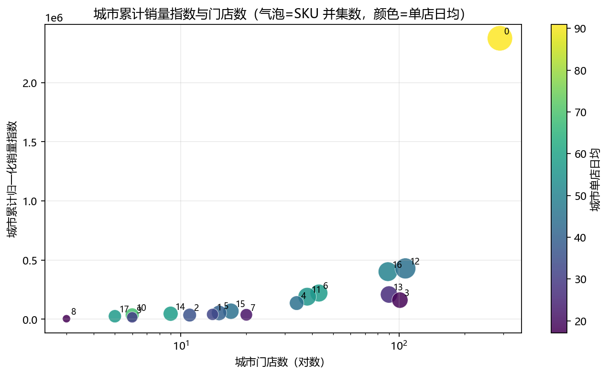
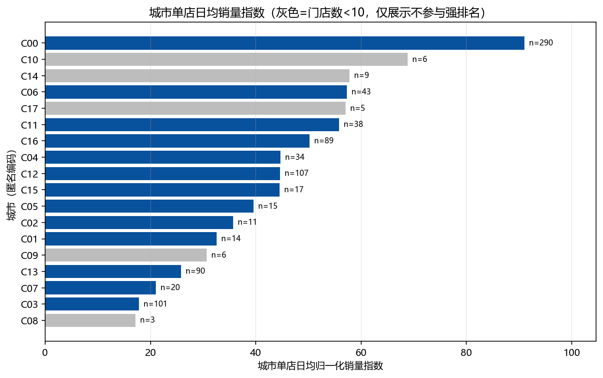
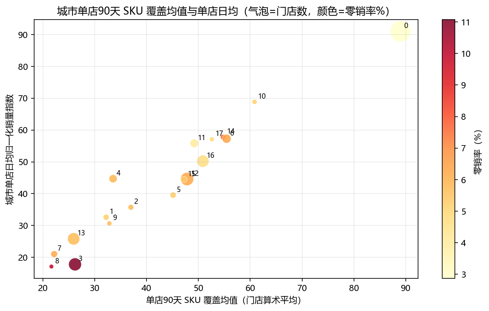
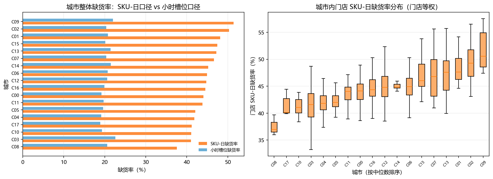
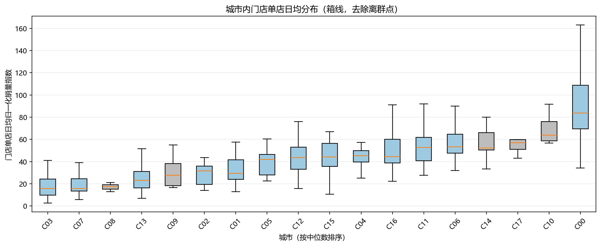
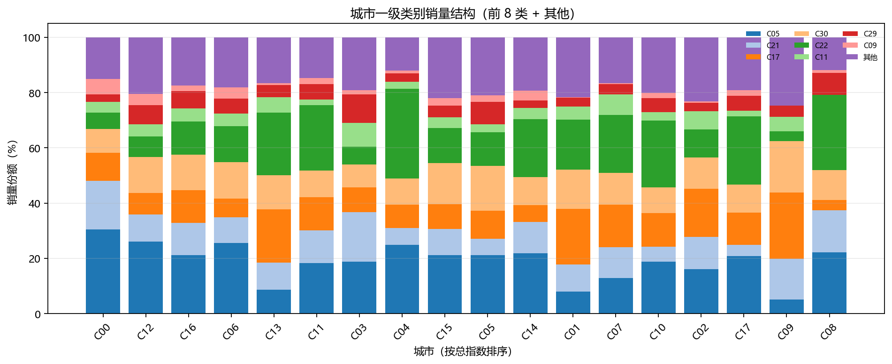

# 第七阶段 P3-A：城市经营对比报告

**项目**：中国数字零售与本地生活经营增长分析
**数据**：FreshRetailNet-50K（Dingdong-Inc，CC BY 4.0），仅 train
**范围**：18 个匿名城市的经营对比（P3 第一批，不含门店四象限、风险标记、结构相似度）
**日期**：2026-11-08

---

## 1. 分析目标与数据范围

### 1.1 目标

1. 区分"城市总量"与"城市单店产出"，避免用总量排名代替经营能力；
2. 检查城市差异是否主要来自门店数量、商品覆盖或单店产出；
3. 描述城市零销率、缺货率、门店分布、集中度与商品结构；
4. 对 City 0 做剔除敏感性，对小城市做展示限制。

### 1.2 数据范围

| 项目 | 说明 |
|---|---|
| 时间 | 2024-03-28 ~ 2024-06-25，90 天 |
| 城市 | 18 个匿名 `city_id` |
| 门店 | 898 家 |
| SKU | 865 个 |
| 销量 | 归一化销量指数 |
| eval | 未读取 |
| 金额 | 不涉及 |

---

## 2. 复用与新增

### 2.1 复用

| 表 | 复用字段 |
|---|---|
| `agg_city_summary` | 城市总量、门店数、门店-日数、单店日均、单店中位、缺货率、门店 CV、份额 |
| `agg_store_summary` | 门店日均、门店缺货率，用于城市内分布 |
| `map_l1.csv` | 一级类别展示编码 |

### 2.2 新增

- 城市 SKU 并集数、单店90天 SKU 覆盖均值/中位/最小/最大；
- 城市零销率（SKU-门店-日口径）；
- 城市类别 HHI、熵、类别数、Top 类别份额；
- 城市门店分布分位数（P10/P50/P90）、Top10% 门店份额、Top1 门店份额；
- 城市内门店缺货率分布；
- City 0 剔除敏感性与 bootstrap 相关区间。

**一致性校验**：新算的 `store_count`、`store_days`、`total_index`、`city_store_day_avg` 与 `agg_city_summary` 完全一致（`finalize_city_table` 内置断言）。

---

## 3. 指标口径

| 指标 | 公式 | 分母/说明 |
|---|---|---|
| 城市累计销量指数 | Σ `sales_index` | 样本内，不代表城市整体市场 |
| 城市门店数 | `COUNT(DISTINCT store_id)` | — |
| 城市门店-日数 | `COUNT(DISTINCT store_id, dt)` | 动态计算，不写死 90 |
| 城市单店日均 | 累计指数 / 门店-日数 | **主对比指标** |
| 城市 SKU 并集数 | `COUNT(DISTINCT product_id)` | 城市 90 天内出现过的不同 SKU |
| 单店90天 SKU 覆盖数 | 每个门店 90 天内出现过的去重 `product_id` 数 | **不是每日在售 SKU 数** |
| 城市单店90天 SKU 覆盖均值 | 上述门店覆盖数的**门店算术平均** | 与并集数不同；相关分析以 18 个城市为样本 |
| 城市零销率 | 零销 SKU-门店-日记录数 / 全部 SKU-门店-日记录数 | **不是门店零销率**；统计单位是 SKU-门店-日 |
| 城市 SKU-日缺货率 | 有 ≥1 个缺货小时的 SKU-门店-日 / 全部 SKU-门店-日 | 6:00–21:59，16 槽位；日级发生率 |
| 城市小时槽位缺货率 | 缺货小时槽位总数 /（16 × SKU-门店-日数） | 6:00–21:59；小时级强度 |
| 城市门店离散度 | 门店日均指数的总体标准差 / 均值 | 城市内门店差异 |
| Top10% 门店份额 | 向上取整 Top10% 门店的指数 / 城市总指数 | 小城市会退化为 Top1 |
| 类别 HHI | Σ(一级类别份额²) | 结构集中度 |
| 类别熵 | −Σ p log p | 结构分散度 |

**关键口径说明**：

1. **单店90天 SKU 覆盖数**：代码为 `COUNT(DISTINCT product_id) GROUP BY store_id`，统计整个 90 天窗口内出现过的去重 SKU，**不是每日在售 SKU 数的均值**。城市单店均值为门店算术平均，不按门店销量加权。
2. **城市零销率**：分子为 `sales_index = 0` 的 SKU-门店-日记录数，分母为全部 SKU-门店-日记录数；不是"门店天中零销的天数占比"。
3. **城市缺货率有两个口径**：
   - `stockout_day_rate`：SKU-门店-日层面"至少有 1 个缺货小时"的比例；
   - `stockout_hour_rate`：16 个有效小时槽位中缺货槽位的占比。
   两者不可互换；城市整体值（SKU-日或小时槽位加权）与城市内门店缺货率分布（门店等权）也不可混用。
4. **SKU 并集数 ≠ 单店覆盖均值**：前者是城市供给池，后者是门店实际铺货宽度。

### 3.1 置信区间方法

- 抽样单位：**城市**；18 个城市有放回抽取 18 个；
- Bootstrap 次数：**1,000**；随机种子：**42**；
- 区间：percentile 2.5% / 97.5%；
- 城市样本仅 18 个，置信区间较宽，**仅作辅助参考，不做显著性结论**。

---

## 4. 城市总量与门店数

| 城市 | 门店数 | 总指数 | 总量份额 | 单店日均 | 单店90天 SKU 覆盖均值 |
|---|---:|---:|---:|---:|---:|
| C00 | 290 | 2,374,623.8 | **52.84%** | 90.982 | 89.00 |
| C12 | 107 | 429,614.6 | 9.56% | 44.612 | 47.82 |
| C16 | 89 | 402,280.9 | 8.95% | 50.222 | 50.88 |
| C06 | 43 | 221,633.1 | 4.93% | 57.270 | 55.44 |
| C13 | 90 | 209,188.1 | 4.66% | 25.826 | 25.96 |
| C11 | 38 | 190,952.3 | 4.25% | 55.834 | 49.21 |
| C03 | 101 | 161,878.5 | 3.60% | 17.808 | 26.22 |
| C04 | 34 | 136,821.5 | 3.04% | 44.713 | 33.56 |
| 其他 10 城 | 106 | 366,667.9 | 8.16% | — | — |

- 城市总指数与门店数 Spearman = **0.9355**（95% CI 0.797–0.988）；剔除 City 0 后 0.9234。
- 前 3 城合计 **71.36%** 的总指数；City 0 一城占 **52.84%**，但只占 **32.29%** 的门店。
- **说明**：城市总指数与门店数呈高度正秩相关，总量排名主要反映门店数量差异，不能直接作为经营能力排名。

---

## 5. 城市单店日均

| 城市 | 门店数 | 单店日均 | 全部排名 | 合格排名* | 单店90天 SKU 覆盖均值 | 零销率 | SKU-日缺货率 |
|---|---:|---:|---:|---:|---:|---:|---:|
| C00 | 290 | **90.982** | 1 | 1 | 89.00 | 2.87% | 44.03% |
| C10 | 6 | 68.843 | 2 | — | 60.83 | 5.18% | 41.10% |
| C14 | 9 | 57.776 | 3 | — | 54.78 | 7.63% | 45.22% |
| C06 | 43 | 57.270 | 4 | 2 | 55.44 | 6.35% | 44.91% |
| C17 | 5 | 57.090 | 5 | — | 52.60 | 4.92% | 41.17% |
| C11 | 38 | 55.834 | 6 | 3 | 49.21 | 4.02% | 43.85% |
| C16 | 89 | 50.222 | 7 | 4 | 50.88 | 4.64% | 44.55% |
| C04 | 34 | 44.713 | 8 | 5 | 33.56 | 5.83% | 41.84% |
| C12 | 107 | 44.612 | 9 | 6 | 47.82 | 6.27% | 44.78% |
| C15 | 17 | 44.497 | 10 | 7 | 47.24 | 5.34% | 47.45% |
| C05 | 15 | 39.554 | 11 | 8 | 45.13 | 5.27% | 42.10% |
| C02 | 11 | 35.733 | 12 | 9 | 37.00 | 5.78% | 50.29% |
| C01 | 14 | 32.606 | 13 | 10 | 32.21 | 5.17% | 48.16% |
| C09 | 6 | 30.668 | 14 | — | 32.83 | 5.69% | 51.40% |
| C13 | 90 | 25.826 | 15 | 11 | 25.96 | 5.70% | 47.21% |
| C07 | 20 | 21.045 | 16 | 12 | 22.20 | 6.22% | 46.62% |
| C03 | 101 | 17.808 | 17 | 13 | 26.22 | **11.08%** | 41.02% |
| C08 | 3 | 17.122 | 18 | — | 21.67 | 9.85% | 37.57% |

\* 合格排名 = 门店数 ≥10 的城市排名；小城市保留展示，不参与强排名。

- 单店日均与门店数 Spearman = **0.0960**（CI −0.483–0.637）；剔除 City 0 后 −0.0736。未观察到明显的单调关系。
- 单店日均与城市 SKU 并集数 Spearman = 0.4654；与**单店90天 SKU 覆盖均值** Spearman = **0.9670**（CI 0.855–0.998），剔除 City 0 后 0.9608。
- **措辞说明**：0.9670 是**秩相关**，不是 R²，不代表"解释了 96.7% 的销量差异"，也不能推出"增加 SKU 覆盖会导致销量提高"。
- 更准确的表述是：**城市层面的单店日均与单店90天 SKU 覆盖均值呈高度正秩相关，提示商品覆盖广度可能是城市间单店销量指数差异的重要伴随因素，但无法据此确认因果关系。**
- City 0 单店日均 90.98、单店90天 SKU 覆盖均值 89.00；其他城市单店日均中位 44.50、覆盖均值中位 45.13。

---

## 6. SKU 覆盖

- 城市 SKU 并集数 30–449；单店90天 SKU 覆盖均值 21.67–89.00。
- 并集数最大的 City 0（449）与最小的 City 8（30）相差 15 倍。
- 并集数与总指数 Spearman = 0.9484，但两者同时与门店数量、SKU 池规模相关，不能拆分为单一原因。
- 与单店日均的秩相关更高的是**单店90天 SKU 覆盖均值**（0.9670），并集数较低（0.4654）；这说明"城市 SKU 池大"不等于"每家店铺得宽"。
- 同样需要强调：这是秩相关，不是因果，也不是方差解释比例。

---

## 7. 零销与缺货

### 7.1 两个缺货口径

| 口径 | 公式 | 范围 | 说明 |
|---|---|---|---|
| 城市 SKU-日缺货率 | 有 ≥1 个缺货小时的 SKU-门店-日 / 全部 SKU-门店-日 | **37.57%–51.40%** | 日级发生率；City 8 最低，City 9 最高 |
| 城市小时槽位缺货率 | 缺货小时槽位总数 /（16 × SKU-门店-日数） | **18.90%–22.56%** | 小时级强度；City 17 最低，City 3 最高 |
| 城市零销率 | 零销 SKU-门店-日 / 全部 SKU-门店-日 | **2.87%–11.08%** | City 0 最低，City 3 最高 |

两者不可互换：日级缺货率回答"多少 SKU-日至少缺过一次"，小时槽位缺货率回答"有效营业小时中有多少比例缺货"。

### 7.2 相关结果

| 关系 | Spearman | 95% CI | 解读 |
|---|---:|---|---|
| 单店日均 vs SKU-日缺货率 | −0.1538 | −0.720–0.398 | 弱且不确定 |
| 单店日均 vs 小时槽位缺货率 | **−0.5315** | −0.864–−0.009 | 中等负秩相关，但 CI 接近 0 |
| 零销率 vs SKU-日缺货率 | −0.0650 | −0.547–0.435 | 几乎无关系 |
| 零销率 vs 小时槽位缺货率 | **+0.6099** | 0.174–0.871 | 中等正秩相关 |

**重要说明**：
- 换一个缺货口径，相关方向和强度都会变化；报告必须同时给出两个口径，不能只报一个。
- 小时槽位口径下"单店日均越高、缺货率越低"和"零销率越高、缺货率越高"只是 18 个城市的秩相关，不是因果；CI 较宽，仅作探索。
- 城市整体缺货率是 SKU-日或小时槽位加权；城市内门店缺货率分布是门店等权，两者不可混用。
- 高销量城市可能因需求压力更容易缺货，也可能因补货能力更强而缺货更低；本数据无法区分，禁止写"缺货导致销量变化"。
- 聚合层面关系不代表门店层面关系；门店级分析留待后续批次。

---

## 8. 门店分布与集中度

| 指标 | 范围 | 说明 |
|---|---|---|
| 城市内门店日均 P10–P90 | 差异明显 | 见 `a1` 的 `store_day_p10/p90` |
| 门店离散度 CV | 0.183–0.704 | City 2 最高，City 10 最低 |
| Top10% 门店份额 | 15.38%–41.06% | 小城市退化为 Top1，需谨慎 |
| 单店日均 vs 门店离散度 | −0.5583（CI −0.882–−0.024） | 呈负秩相关，提示单产较高的城市门店间差异较小；仅描述，不因果 |

- City 13（90 店，CV 0.605）与 City 3（101 店，CV 0.597）属于"门店多、内部分化大、单店产出低"；
- City 2（11 店，CV 0.704，Top10% 39.15%）门店少但离散最大，均值代表性弱；
- City 8 仅 3 店，Top10% 份额 41.06% 实际是 Top1 份额，不能解读为"高度集中"。

---

## 9. 城市商品结构

| 指标 | 范围 | 说明 |
|---|---|---|
| 一级类别数 | 见 `a1.category_count` | 城市覆盖的类别数 |
| 类别 HHI | 0.1045–0.1925 | City 4 最集中，City 2 最分散 |
| 类别熵 | 见 `a1.category_entropy` | 与 HHI 反向 |
| Top 类别份额 | 见 `a1.top_category_share` | 结构头部依赖 |

结构差异存在但不算剧烈：HHI 最高 0.1925（City 4）、最低 0.1045（City 2）。商品结构图仅用于描述，不判断"结构好坏"。

---

## 10. City 0 剔除敏感性

| 指标 | City 0 | 其他城市中位 | 备注 |
|---|---:|---:|---|
| 门店份额 | 32.29% | — | 290 / 898 |
| 总量份额 | 52.84% | — | 一城超过一半 |
| 单店日均 | 90.982 | 44.497 | City 0 约为其他中位的 2 倍 |
| 单店90天 SKU 覆盖均值 | 89.00 | 45.13 | 也约为 2 倍 |
| 零销率 | 2.87% | 5.70% | City 0 更低 |
| SKU-日缺货率 | 44.03% | 44.78% | 接近 |
| 小时槽位缺货率 | 19.22% | 20.39% | City 0 略低 |

**相关性稳定性**：

| 关系 | 全部 18 城 | 剔除 City 0 | 变化 |
|---|---:|---:|---|
| 总指数 vs 门店数 | 0.9355 | 0.9234 | 很小 |
| 单店日均 vs 门店数 | 0.0960 | −0.0736 | 仍接近 0 |
| 单店日均 vs 单店90天 SKU 覆盖均值 | 0.9670 | 0.9608 | 很小 |
| 单店日均 vs SKU-日缺货率 | −0.1538 | −0.1422 | 很小 |
| 单店日均 vs 小时槽位缺货率 | −0.5315 | −0.4706 | 方向不变 |
| 零销率 vs 小时槽位缺货率 | 0.6099 | 0.5711 | 方向不变 |

**结论**：未发现主结论依赖 City 0 单城；剔除后秩相关方向与量级基本稳定。报告仍保留 City 0，并附敏感性表。

---

## 11. 小城市展示与排名限制

门店数 <10 的城市共 **5 个**：

| 城市 | 门店数 | 单店日均 | 说明 |
|---|---:|---:|---|
| C10 | 6 | 68.843 | 展示，不参与强排名 |
| C14 | 9 | 57.776 | 展示，不参与强排名 |
| C17 | 5 | 57.090 | 展示，不参与强排名 |
| C9 | 6 | 30.668 | 展示，不参与强排名 |
| C8 | 3 | 17.122 | 展示，不参与强排名 |

- 图中灰色标注；
- 合格排名只覆盖 13 个城市（≥10 店）；
- 小城市的 Top10% 份额、门店分布、类别 HHI 波动大，不作强结论。

---

## 12. 图表

| 图 | 文件 | 回答的问题 |
|---|---|---|
| F1 | `f1_city_total_vs_stores.png` | 城市总量与门店数的关系 |
| F2 | `f2_city_store_day_rank.png` | 剔除门店数后的城市单产 |
| F3 | `f3_city_store_distribution.png` | 城市内部门店差异 |
| F4 | `f4_city_sku_vs_store_day.png` | 单店90天 SKU 覆盖均值与单产的关系 |
| F5 | `f5_city_stockout.png` | 城市 SKU-日/小时槽位缺货率与门店缺货分布 |
| F6 | `f6_city_category_structure.png` | 城市一级类别结构 |

所有销量轴均为"归一化销量指数"，不含金额或件数。

---

## 13. 关键发现

1. **城市总量与门店数高度正秩相关**（0.9355）：总量排名主要反映门店数量差异，不能直接作为经营能力排名；City 0 以 32.29% 的门店贡献 52.84% 的总量。
2. **城市单店日均与门店数未观察到明显单调关系**（0.0960）：不能把总量排名当单店产出排名。
3. **城市单店日均与单店90天 SKU 覆盖均值呈高度正秩相关**（0.9670，95% CI 0.855–0.998）：提示商品覆盖广度可能是城市间单店销量指数差异的重要伴随因素，但无法据此确认因果关系。该值是秩相关，不是 R²，不代表解释了 96.7% 的差异。
4. **SKU 并集数与单店日均只有中等秩相关**（0.4654）：说明"城市 SKU 池大"不等于"每家店铺得宽"。
5. **缺货口径会改变结论**：单店日均 vs SKU-日缺货率 −0.1538，vs 小时槽位缺货率 −0.5315；零销率 vs SKU-日缺货率 −0.0650，vs 小时槽位缺货率 +0.6099。18 城样本下 CI 较宽，仅作探索，不能因果化。
6. **单店日均与门店离散度呈负秩相关**（−0.5583）：提示单产较高的城市门店间差异较小；仅描述性关联。
7. **集中度差异主要受门店数影响**：Top10% 份额 15.38%–41.06%，小城市退化为 Top1，不宜强解读。
8. **未发现主结论依赖 City 0 单城**：剔除后核心秩相关从 0.9355→0.9234、0.9670→0.9608，方向与量级基本稳定。

---

## 14. 数据限制与不可回答的问题

| # | 限制 | 不可回答 |
|---|---|---|
| 1 | 城市匿名、无行政区划 | 真实城市市场、人口、收入、商圈 |
| 2 | 门店匿名、无位置/面积/业态 | 选址、门店类型、租金 |
| 3 | 无金额、无成本 | GMV、收入、毛利 |
| 4 | 归一化销量指数 | 真实件数、绝对市场规模 |
| 5 | 仅 90 天 | 长期趋势、年度季节性 |
| 6 | 18 个城市、门店数 3–290 | 小城市稳定排名、严格显著性 |
| 7 | 无门店业态/面积 | 不能解释"为什么 SKU 少/单产低" |
| 8 | 无用户/订单 | 客单价、复购、用户来源 |
| 9 | 观察性数据 | 任何因果结论 |
| 10 | 不允许跨数据集关联 | 不能补充城市人口/消费等外部属性 |

---

## 15. 文件与运行验证

### 15.1 新增文件

| 类别 | 文件 |
|---|---|
| 代码 | `src/freshretail/analysis/p3_city.py` |
| 入口 | `scripts/run_p3a.py` |
| 结果表 | `data/analysis/p3/a1_city_metrics.csv`、`a2_city_correlations.csv`、`a3_city0_sensitivity.csv`、`a4_city_category_long.csv`、`summary.json` |
| 图表 | `reports/figures/p3/` 下 6 张 PNG |
| 测试 | `tests/test_p3_city.py` |
| 报告 | `07_P3A城市经营对比报告.md` |

### 15.2 运行验证

| 项目 | 结果 |
|---|---|
| 分析运行 | `python scripts/run_p3a.py` 成功 |
| 城市数 | 18 |
| 总指数合计 | 4,493,660.787，与 P1 一致 |
| 一致性校验 | 复用表与新算 `store_count/store_days/total_index/per_store_day` 完全一致 |
| 图表 | 6 张，均非空 |
| 测试 | **35 passed**（P1/P2/P3 全部通过，P3 新增 6 项） |
| 原始数据 | 未修改 |
| eval | 未读取 |
| P1/P2 文件 | 未修改 |
| Git | 未提交、未推送 |

### 15.3 P3-A 未做

- 门店四象限；
- 门店风险标记；
- 门店结构相似度；
- 门店级缺货关联分析。

这些留待后续批次。

---

## 附录：执行边界

- 仅使用 train 90 天；
- 未读取 eval；
- 未修改原始 Parquet、R001–R012、P1/P2 代码与结果；
- 未建库、未下载新数据、未做仪表盘；
- 未执行 Git commit / push。
