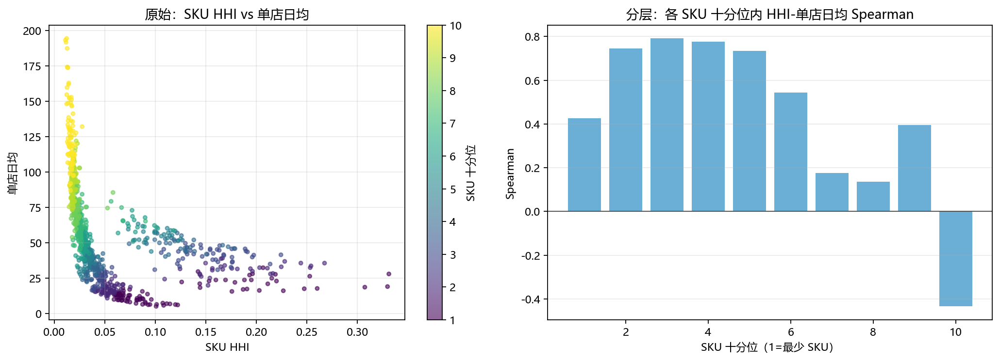

# 第七阶段 P3-C：门店商品结构分析报告

**项目**：中国数字零售与本地生活经营增长分析
**数据**：FreshRetailNet-50K（Dingdong-Inc，CC BY 4.0），仅 train
**范围**：门店商品覆盖、集中度、类别结构、结构相似度与聚类
**日期**：2026-11-08

---

## 1. 分析目标与样本

### 1.1 目标

1. 描述门店商品组合的宽度与销售集中度；
2. 比较 32 个一级类别的覆盖率与份额；
3. 检查结构指标与单店规模、单 SKU 效率、P3-B 相对效率的关系；
4. 描述结构相似性与聚类，不命名真实业态；
5. 检查稀有类别是否影响聚类结构。

### 1.2 样本

| 项目 | 结果 |
|---|---:|
| 门店总数 | 898 |
| 结构主分析（SKU≥10） | **888** |
| 不参与结构对比（SKU<10） | 10，保留基础结构表 |
| 一级类别 | 32 |
| 类别覆盖率分母 | 898（覆盖率） |
| 结构指标/相似度/聚类分母 | 888 |

**数据复用**：P3-B `b1_store_metrics.csv`（单店日均、单 SKU 日均、P3-B 残差、四象限、SKU 数）、`clean_train.parquet`、P2 `map_l1.csv`。未重算 P3-B 象限。

---

## 2. 指标公式

### 2.1 门店结构

所有份额均在**门店内部**按 `sales_index` 归一化，`Σ share = 1`。

| 指标 | 公式 | 粒度/分母 |
|---|---|---|
| SKU HHI | Σ(该 SKU 门店内销量份额²) | 门店；分母门店总销量 |
| 有效 SKU 数 | 1 / SKU HHI | 门店 |
| Top1 SKU 份额 | 最大 SKU 销量 / 门店总销量 | 门店 |
| Top5 SKU 份额 | 前 5 SKU 销量 / 门店总销量 | 门店 |
| 类别 HHI | Σ(一级类别份额²) | 门店 |
| 类别熵 | −Σ p_k log(p_k) | 门店 |
| 类别数 | `COUNT(DISTINCT first_category_id)` | 门店，90 天去重 |
| Top 类别份额 | 最大一级类别份额 | 门店 |

### 2.2 类别覆盖

| 指标 | 公式 | 分母 |
|---|---|---|
| 类别门店覆盖数 | 该类别有销量的门店数 | — |
| 类别覆盖率 | 覆盖门店数 / 898 | 898 |
| 类别份额中位 | 有销量门店中该类别份额的中位 | 有销量门店 |
| 类别 SKU 数中位 | 有销量门店中该类别去重 SKU 数的中位 | 有销量门店 |

---

## 3. 门店结构结果

### 3.1 分布

| 指标 | 中位 | P90 |
|---|---:|---:|
| SKU HHI | **0.0325** | 0.1380 |
| 有效 SKU 数 | 30.8 | 56.6 |
| Top1 SKU 份额 | 8.03% | 33.91% |
| Top5 SKU 份额 | 29.26% | 56.04% |
| 一级类别数 | 15 | 19 |
| 类别 HHI | 0.1573 | 0.2212 |
| 类别熵 | 2.182 | 2.393 |

- SKU HHI 与 SKU 数 Spearman **−0.900**，HHI 基本是覆盖广度的镜像；
- 高 HHI 不等于"结构差"，只说明销量集中在少数 SKU；必须同时看 SKU 数。

### 3.2 确定性等样本量十分位

按 `sku_count` 升序、`store_id` 升序排序，`np.array_split` 切成 10 组；相同 SKU 数的门店可能在边界进入不同组，不删除任何门店。

| 十分位 | n | SKU 范围 | HHI 中位 | 单店日均中位 | 箱内 HHI-单店日均 Spearman |
|---|---:|---:|---:|---:|---:|
| 1 | 89 | 10–20 | 0.0872 | 13.19 | **+0.426** |
| 2 | 89 | 20–27 | 0.0580 | 19.71 | **+0.745** |
| 3 | 89 | 27–35 | 0.0565 | 31.82 | **+0.791** |
| 4 | 89 | 35–42 | 0.0408 | 35.50 | **+0.776** |
| 5 | 89 | 42–50 | 0.0351 | 43.40 | **+0.735** |
| 6 | 89 | 51–59 | 0.0298 | 51.27 | **+0.544** |
| 7 | 89 | 59–72 | 0.0254 | 63.46 | +0.175 |
| 8 | 89 | 72–85 | 0.0213 | 75.01 | +0.136 |
| 9 | 88 | 85–98 | 0.0185 | 92.29 | +0.395 |
| 10 | 88 | 98–164 | 0.0162 | 122.80 | **−0.434** |

所有组 n≥20，无"样本不足"组。

---

## 4. 类别覆盖

| 类别 | 覆盖门店 | 覆盖率 | 份额中位 |
|---|---:|---:|---:|
| C21 | 890 | 99.11% | 13.68% |
| C30 | 886 | 98.66% | 10.79% |
| C05 | 886 | 98.66% | 24.88% |
| C29 | 883 | 98.33% | 4.52% |
| C17 | 876 | 97.55% | 9.74% |
| C22 | 839 | 93.43% | 6.48% |
| C11 | 827 | 92.09% | 4.27% |

**稀有类别（<10 家门店）**：

| 类别 | 门店数 |
|---|---:|
| C02 | 6 |
| C20 | 3 |
| C10 | 2 |
| C03 | 2 |

- 32 类中覆盖率 2–890 家，差异极大；
- 高覆盖 ≠ 高份额：C21 覆盖 99.1%、份额中位 13.68%；C05 覆盖 98.66%、份额中位 24.88%；
- 稀有类别保留并标注，不进入聚类业务解释。

---

## 5. 结构与经营表现

### 5.1 原始相关

| 关系 | n | Spearman | 门店 Bootstrap 95% CI | 城市聚类 Bootstrap 95% CI |
|---|---:|---:|---|---|
| SKU HHI vs 单店日均 | 888 | **−0.771** | −0.8019 – −0.7358 | −0.8828 – −0.2017 |
| SKU HHI vs 单 SKU 日均 | 888 | +0.125 | 0.0413 – 0.2023 | −0.2191 – 0.6495 |
| SKU HHI vs P3-B 残差 | 888 | +0.320 | 0.2460 – 0.3861 | −0.0137 – 0.7591 |
| Top1 份额 vs 单 SKU 日均 | 888 | +0.178 | 0.0954 – 0.2542 | −0.1887 – 0.7062 |
| 类别数 vs 单店日均 | 888 | **+0.880** | 0.8631 – 0.8936 | 0.7232 – 0.9149 |
| 类别 HHI vs 单店日均 | 888 | −0.106 | −0.1637 – −0.0418 | −0.3845 – 0.0084 |

### 5.2 Bootstrap 方法说明

**门店 Bootstrap**：
- 抽样单位：门店；
- 每次有放回抽取 **888** 家；
- 重复 **1,000** 次，随机种子 **42**；
- 计算前按 `store_id` 确定性排序，消除输入行序影响；
- Spearman 相关；percentile 2.5% / 97.5% 构造 95% 区间。

**城市 Cluster Bootstrap**：
- 抽样单位：**18 个城市**；
- 每次有放回抽取 **18 个城市**；
- **允许同一城市重复抽中**；
- 每次抽样后纳入被抽中城市的**全部门店**；城市重复则门店重复；
- 每次门店样本量 **207–1,894，中位 869**；
- 重复 **1,000** 次，随机种子 **42**；
- Spearman 相关；percentile 2.5% / 97.5% 构造 95% 区间。

**解释边界**：

1. 城市数只有 **18 个**，Bootstrap 区间可能存在不稳定性；
2. 不同城市门店规模差异较大（3–289 家），重采样后的门店样本量会变化；
3. CI 是否跨 0 **不能直接当作正式显著性检验**；
4. Bootstrap 结果仅用于探索性不确定性评估，不作因果或强显著性结论。

### 5.3 原始相关与分层相关的差异

- **原始 HHI-单店日均 = −0.771**，但按 SKU 十分位分层后，**前 9 个 SKU 数量十分位组的相关系数为正**，其中前 6 组的正相关较强（**+0.426 到 +0.791**），第 10 组为负（**−0.434**）。
- 这是典型的 **Simpson 悖论/覆盖广度混杂**：高 SKU 门店 HHI 低、销量高，导致原始负相关；在同一 SKU 覆盖组内，HHI 与销量的方向并不稳定。
- 因此**不能得出"集中度高会降低销量"或"分散度高更好"的稳定结论**。
- 类别数与单店日均 +0.880 同样是覆盖广度的机械结果；不能解释为"品类越多越强"。

### 5.3 结论

结构指标**不能支持稳定的经营表现结论**。可用于描述：
- 门店商品宽度与集中度；
- 不同 SKU 覆盖层内的结构差异；
- 与 P3-B 相对效率的弱关联（城市聚类 CI 跨 0）。

不得用于门店排名、奖惩或经营能力评价。

---

## 6. 结构相似度与聚类

### 6.1 相似度

| 指标 | 城市内 | 城市间 |
|---|---:|---:|
| 一级类别份额余弦均值 | **0.905** | 0.723 |
| SKU 集合 Jaccard 均值 | **0.373** | 0.136 |

- 城市内门店结构明显更相似（余弦差 0.182，Jaccard 差 0.238）；
- 这只是样本内结构相似性，不能推断真实商圈或业态；
- Jaccard 基于 **100 家分层抽样**（SKU 十分位每层 10 家，seed 42），名单见 `c9_jaccard_sample.csv`；
- 100 家随机抽样门店内部**无重复**；4 家典型门店中 **S0539 与抽样名单重叠**，实际额外新增 **3 家**不同门店；
- **Jaccard 计算仍只使用原定 100 家抽样门店**，不因典型门店展示而改变样本。

### 6.2 聚类

- 方法：32 维门店内类别份额 → **L2 归一化 → Euclidean 距离 → Ward linkage**；
- 主图树状图不强行切 k；附录 k=4 仅作展示；
- k=4 簇规模：**G1 189、G2 181、G3 168、G4 350**；
- 簇编号 `G1`–`G4`，**不命名真实业态**。

### 6.3 稀有类别敏感性

- 稀有标准：覆盖门店 <10 家；本数据为 **C02/C20/C10/C03** 共 4 类；
- 敏感性：剔除稀有类别后，对剩余 28 类重新归一化，再 L2 + Euclidean + Ward；
- 结果：**ARI(k=4) = 1.000**，聚类距离矩阵相关 **0.999999**，簇规模完全不变（189/181/168/350）。

**结论**：在本次样本中，稀有类别对 k=4 聚类结构没有实质影响；但这只说明它们销量份额极小，不代表稀有类别没有业务意义。

---

## 7. 与 P3-B 四象限交叉

| 象限 | 门店数 | SKU 数中位 | SKU HHI 中位 | Top1 份额中位 | 类别数中位 | 类别 HHI 中位 |
|---|---:|---:|---:|---:|---:|---:|
| Q1 高规模·相对高效率 | 261 | 75 | 0.0236 | 6.31% | 18 | 0.1566 |
| Q2 高规模·相对低效率 | 183 | 80 | 0.0202 | 5.99% | 18 | 0.1582 |
| Q3 低规模·相对高效率 | 183 | 29 | **0.1347** | **33.63%** | 11 | **0.2127** |
| Q4 低规模·相对低效率 | 261 | 35 | 0.0400 | 9.02% | 12 | 0.1421 |

- Q3 的结构更集中（HHI、Top1、类别 HHI 更高，类别数更少），但这与 SKU 少、规模低同时发生；
- **不能把 Q3 的高集中解释为经营风险，也不能把 Q1/Q2 的低集中解释为优势**；
- 四象限本身是 P3-B 的弱拟合探索性分组，本表仅作画像交叉，不重算象限。

---

## 8. 图表

| 图 | 文件 | 内容 |
|---|---|---|
| F1 | `f1_store_hhi_distribution.png` | SKU HHI 分布 |
| F2 | `f2_sku_vs_hhi.png` | SKU 数与 HHI |
| F3 | `f3_top_share_distribution.png` | Top1/Top5 份额分布 |
| F4 | `f4_category_count_vs_scale.png` | 类别数与单店日均（颜色=十分位） |
| F5 | `f5_category_hhi_entropy.png` | 类别 HHI 与熵 |
| F6 | `f6_category_penetration.png` | 类别覆盖率 vs 份额中位 |
| F7 | `f7_raw_vs_stratified.png` | 原始 vs 分层 HHI-销量关系 |
| F8 | `f8_hhi_vs_p3b_residual.png` | HHI 与 P3-B 残差 |
| F9 | `f9_structure_heatmap.png` | 门店类别结构热图 |
| F10 | `f10_quadrant_structure.png` | 四象限 × 结构指标 |
| A1 | `a1_dendrogram.png` | 层次聚类树状图 |
| A2 | `a2_typical_store_structure.png` | 典型门店类别堆叠图 |

典型门店（四分组中心，规则确定）：

| 组 | 门店 | 城市 | SKU 数 | SKU HHI |
|---|---|---:|---:|---:|
| 低 SKU·低 HHI | S0539 | C06 | 44 | 0.0306 |
| 低 SKU·高 HHI | S0682 | C13 | 29 | 0.0995 |
| 高 SKU·低 HHI | S0405 | C00 | 83 | 0.0208 |
| 高 SKU·高 HHI | S0022 | C17 | 56 | 0.0632 |

> 典型门店 S0539 同时出现在 100 家 Jaccard 抽样名单中；Jaccard 计算仍只使用该 100 家样本，典型门店展示不改变样本。

---

## 9. 关键发现

1. **HHI 主要是 SKU 覆盖广度的镜像**（Spearman −0.900），不是独立的经营质量指标。
2. **原始相关与分层结果方向不一致**：原始 −0.771；分层后前 9 个 SKU 数量十分位组的相关系数为正，其中前 6 组较强（+0.426–+0.791），第 10 组为负（−0.434）。不能给出稳定的集中度-销量结论。
3. **类别数与单店日均 +0.880**，同样是覆盖广度的机械结果，不能解释为经营能力。
4. **HHI 与单 SKU 日均仅 +0.125、与 P3-B 残差 +0.320**，且城市聚类 CI 均跨 0，证据弱。
5. **城市内结构相似度高于城市间**（余弦 0.905 vs 0.723），说明结构有城市聚集，但不能推断真实商圈。
6. **稀有类别对聚类无实质影响**（ARI=1.0），因为份额极小；仍需标注，不能据此解释结构类型。
7. **Q3 结构最集中**（HHI 0.135、Top1 33.6%），但这是低 SKU/低规模的结果，不是经营风险证据。

---

## 10. 数据限制

| # | 限制 | 影响 |
|---|---|---|
| 1 | 类别匿名 | 不能给出真实品类语义 |
| 2 | 无价格/成本/金额 | 不能做品类毛利、价格带 |
| 3 | 销量份额 ≠ 陈列面积/SKU 数份额 | 不能判断结构是否合理 |
| 4 | SKU 覆盖为 90 天去重 | 不是每日在售/上架计划 |
| 5 | HHI 与 SKU 数 −0.900 | 高 HHI 可能只是 SKU 少 |
| 6 | 分层后符号不稳定 | 无统一结构-表现结论 |
| 7 | 稀有类别 2–6 店 | 覆盖率/相似度对长尾敏感 |
| 8 | 无门店面积/业态 | 不能解释结构差异原因 |
| 9 | 聚类为统计分组 | 不是真实商圈/业态 |
| 10 | 观察性数据 | 任何因果结论 |

---

## 11. 文件与验证

### 11.1 新增文件

| 类别 | 文件 |
|---|---|
| 代码 | `src/freshretail/analysis/p3c_structure.py` |
| 入口 | `scripts/run_p3c.py` |
| 结果表 | `data/analysis/p3c/` 下 `c1`–`c11`、`summary.json` |
| 图表 | `reports/figures/p3c/` 下 12 张（10 主 + 2 附录） |
| 测试 | `tests/test_p3c_structure.py` |
| 报告 | `07_P3C商品结构分析报告.md` |

### 11.2 验证

| 项目 | 结果 |
|---|---|
| 分析运行 | `python scripts/run_p3c.py` 成功 |
| 门店数 | 898；结构模型 888；SKU<10 保留 10 |
| 总指数合计 | 4,493,660.787，与 P1 一致 |
| 十分位 | 10 组，n=89×8 + 88×2，无门店丢失 |
| 稀有类别 | 4 类；剔除后 ARI=1.0、距离相关 0.999999 |
| 测试 | **45 passed in 3.71s**（P1/P2/P3-A/P3-B/P3-C） |
| 原始数据 | 未修改 |
| eval | 未读取 |
| P1/P2/P3-A/P3-B | 未修改 |
| P3-D | 未开展 |
| Git | 未提交、未推送 |

---

## 12. 结论

P3-C 完成了门店商品结构的描述性分析，但不能支持稳定的经营表现结论：

- 结构指标（HHI、Top 份额、类别 HHI）与 SKU 覆盖数高度耦合；
- 原始负相关在 SKU 分层后方向反转，说明是覆盖广度混杂；
- HHI 与单 SKU 效率、P3-B 残差的关系弱，且城市聚类 CI 跨 0；
- 稀有类别对聚类无实质影响；
- 结构相似度存在城市聚集，但只能描述样本内相似性。

因此，P3-C 结果适合做**结构画像、门店分组展示、后续专题假设来源**，不适合门店排名、奖惩或经营能力评价。
